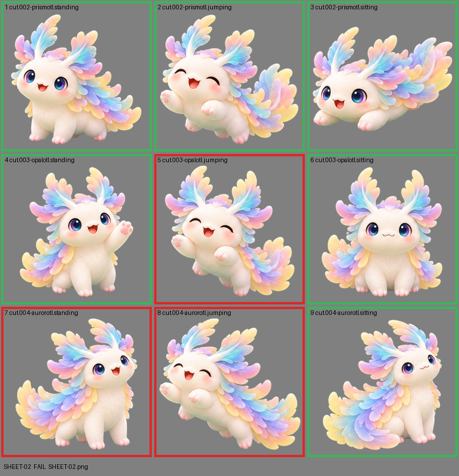

# SHEET-02: Mascot family (3 stages x 3 poses): Prismotl, Opalotl, Aurorotl

- File: `wildkin-production/incoming/SHEET-02.png`
- sha256: `068f31b69f05669ee320069ea6f8325cce149c49dc01d44fdbfd260914ade110`
- Checked: 2026-10-14T01:42:07Z
- Result: **fail**

## Errors (block approval)

- cell 5: subject touches the cell edge (clipped): top
- cell 7: subject touches the cell edge (clipped): top
- cell 8: subject touches the cell edge (clipped): top+right

## Notes (do not block)

- cell 1: margin is tight (9 px); the spec asks for about 10%
- cell 2: margin is tight (7 px); the spec asks for about 10%
- cell 4: margin is tight (11 px); the spec asks for about 10%
- cell 6: margin is tight (8 px); the spec asks for about 10%
- cell 9: margin is tight (5 px); the spec asks for about 10%

| Cell | Asset | Result |
|---|---|---|
| 1 | cut.002-prismotl.standing | ok |
| 2 | cut.002-prismotl.jumping | ok |
| 3 | cut.002-prismotl.sitting | ok |
| 4 | cut.003-opalotl.standing | ok |
| 5 | cut.003-opalotl.jumping | subject touches the cell edge (clipped): top |
| 6 | cut.003-opalotl.sitting | ok |
| 7 | cut.004-aurorotl.standing | subject touches the cell edge (clipped): top |
| 8 | cut.004-aurorotl.jumping | subject touches the cell edge (clipped): top+right |
| 9 | cut.004-aurorotl.sitting | ok |
