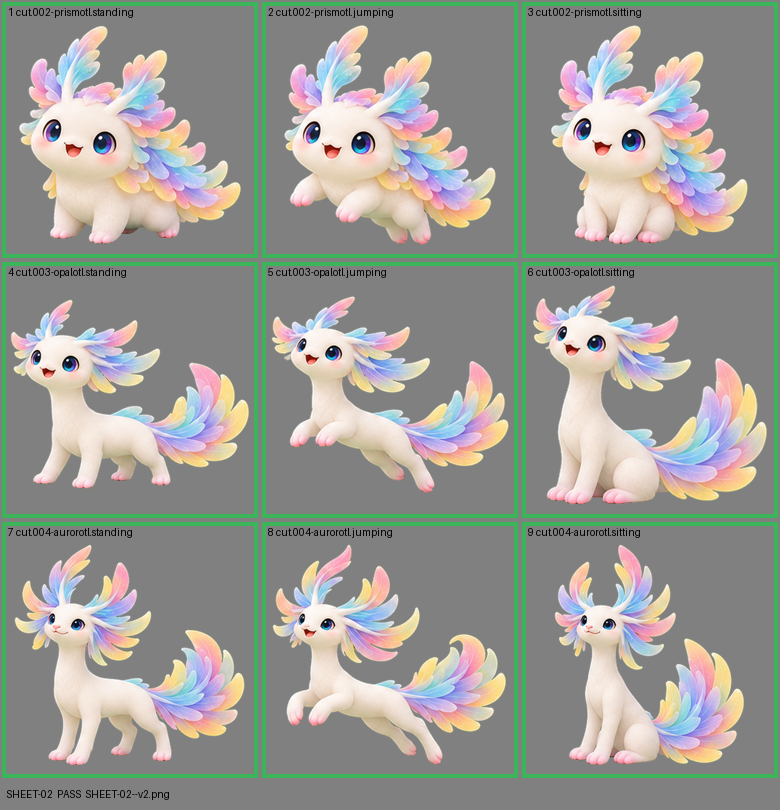

# SHEET-02: Mascot family (3 stages x 3 poses): Prismotl, Opalotl, Aurorotl

- File: `wildkin-production/incoming/SHEET-02--v2.png`
- sha256: `acc2976fad9473bab2eb1e2fb43302d7bbe9beafcc944e8edc138a3762839dfd`
- Checked: 2026-10-13T11:37:13Z
- Result: **pass**

## Notes (do not block)

- cell 4: margin is tight (11 px); the spec asks for about 10%
- cell 7: margin is tight (15 px); the spec asks for about 10%
- cell 9: margin is tight (12 px); the spec asks for about 10%

| Cell | Asset | Result |
|---|---|---|
| 1 | cut.002-prismotl.standing | ok |
| 2 | cut.002-prismotl.jumping | ok |
| 3 | cut.002-prismotl.sitting | ok |
| 4 | cut.003-opalotl.standing | ok |
| 5 | cut.003-opalotl.jumping | ok |
| 6 | cut.003-opalotl.sitting | ok |
| 7 | cut.004-aurorotl.standing | ok |
| 8 | cut.004-aurorotl.jumping | ok |
| 9 | cut.004-aurorotl.sitting | ok |
