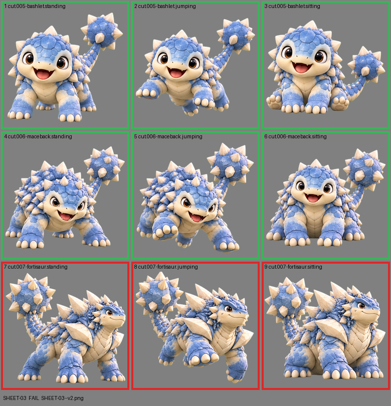

# SHEET-03: Mascot family (3 stages x 3 poses): Bashlet, Maceback, Fortisaur

- File: `wildkin-production/incoming/SHEET-03--v2.png`
- sha256: `20e200697429ca4863e3f5f7210cace0f746987f8dd586638e28b1112801248b`
- Checked: 2026-10-13T15:16:33Z
- Result: **fail**

## Errors (block approval)

- cell 7: subject touches the cell edge (clipped): right
- cell 8: subject touches the cell edge (clipped): left+top
- cell 9: subject touches the cell edge (clipped): left

## Notes (do not block)

- cell 4: margin is tight (6 px); the spec asks for about 10%
- cell 5: margin is tight (8 px); the spec asks for about 10%
- cell 6: margin is tight (11 px); the spec asks for about 10%

| Cell | Asset | Result |
|---|---|---|
| 1 | cut.005-bashlet.standing | ok |
| 2 | cut.005-bashlet.jumping | ok |
| 3 | cut.005-bashlet.sitting | ok |
| 4 | cut.006-maceback.standing | ok |
| 5 | cut.006-maceback.jumping | ok |
| 6 | cut.006-maceback.sitting | ok |
| 7 | cut.007-fortisaur.standing | subject touches the cell edge (clipped): right |
| 8 | cut.007-fortisaur.jumping | subject touches the cell edge (clipped): left+top |
| 9 | cut.007-fortisaur.sitting | subject touches the cell edge (clipped): left |
