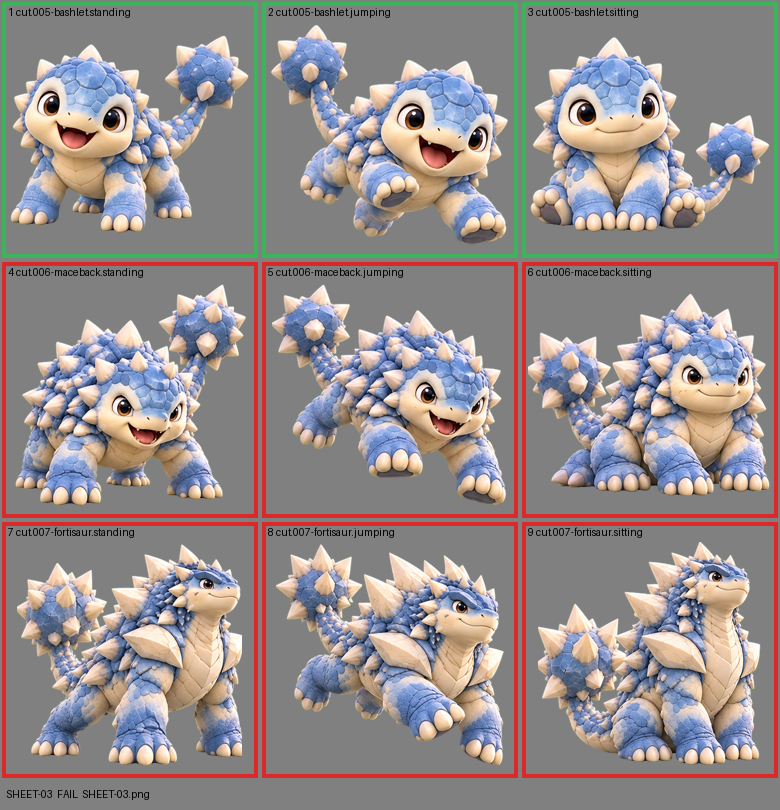

# SHEET-03: Mascot family (3 stages x 3 poses): Bashlet, Maceback, Fortisaur

- File: `wildkin-production/incoming/SHEET-03.png`
- sha256: `4357c197eec7f3508d560250bb02af51a4a3804b70e8e8ba05c7dc968bcaa9be`
- Checked: 2026-10-13T11:25:52Z
- Result: **fail**

## Errors (block approval)

- cell 4: subject touches the cell edge (clipped): right
- cell 5: subject touches the cell edge (clipped): left
- cell 6: subject touches the cell edge (clipped): left
- cell 7: subject touches the cell edge (clipped): left+right
- cell 8: subject touches the cell edge (clipped): left+right
- cell 9: subject touches the cell edge (clipped): left+top+right

## Notes (do not block)

- cell 3: margin is tight (7 px); the spec asks for about 10%

| Cell | Asset | Result |
|---|---|---|
| 1 | cut.005-bashlet.standing | ok |
| 2 | cut.005-bashlet.jumping | ok |
| 3 | cut.005-bashlet.sitting | ok |
| 4 | cut.006-maceback.standing | subject touches the cell edge (clipped): right |
| 5 | cut.006-maceback.jumping | subject touches the cell edge (clipped): left |
| 6 | cut.006-maceback.sitting | subject touches the cell edge (clipped): left |
| 7 | cut.007-fortisaur.standing | subject touches the cell edge (clipped): left+right |
| 8 | cut.007-fortisaur.jumping | subject touches the cell edge (clipped): left+right |
| 9 | cut.007-fortisaur.sitting | subject touches the cell edge (clipped): left+top+right |
