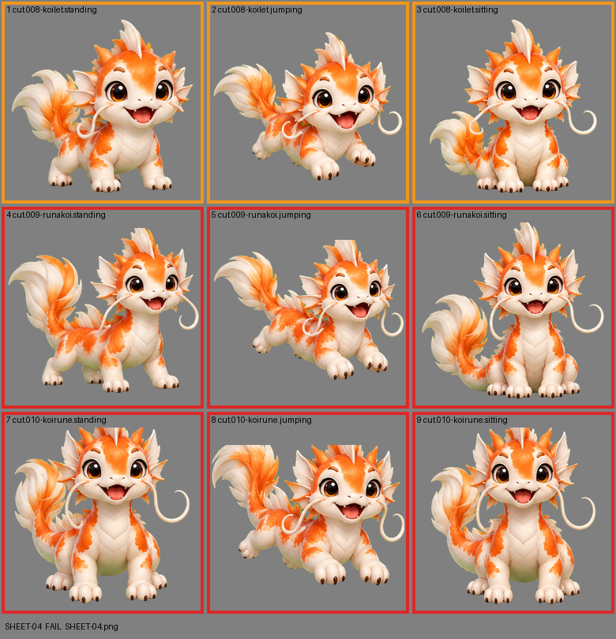

# SHEET-04: Mascot family (3 stages x 3 poses): Koilet, Runakoi, Koirune

- File: `wildkin-production/incoming/SHEET-04.png`
- sha256: `aecd240b59fda466042fb11ca4ee9deb417f82e7c09700d18971c4d347be5154`
- Checked: 2026-10-14T01:43:40Z
- Result: **fail**

## Errors (block approval)

- cell 4: subject touches the cell edge (clipped): top+right
- cell 5: subject touches the cell edge (clipped): top+right
- cell 6: subject touches the cell edge (clipped): top
- cell 7: subject touches the cell edge (clipped): top
- cell 8: subject touches the cell edge (clipped): left+top+right
- cell 9: subject touches the cell edge (clipped): top

## Warnings (need a human look)

- cell 1: 2 stray mark(s) removed ("!" bursts, sparkles); check the piece
- cell 2: 2 stray mark(s) removed ("!" bursts, sparkles); check the piece
- cell 3: 1 stray mark(s) removed ("!" bursts, sparkles); check the piece
- cell 4: 2 stray mark(s) removed ("!" bursts, sparkles); check the piece
- cell 5: 4 stray mark(s) removed ("!" bursts, sparkles); check the piece
- cell 6: 2 stray mark(s) removed ("!" bursts, sparkles); check the piece

## Notes (do not block)

- cell 2: margin is tight (7 px); the spec asks for about 10%

| Cell | Asset | Result |
|---|---|---|
| 1 | cut.008-koilet.standing | 2 stray mark(s) removed ("!" bursts, sparkles); check the piece |
| 2 | cut.008-koilet.jumping | 2 stray mark(s) removed ("!" bursts, sparkles); check the piece |
| 3 | cut.008-koilet.sitting | 1 stray mark(s) removed ("!" bursts, sparkles); check the piece |
| 4 | cut.009-runakoi.standing | subject touches the cell edge (clipped): top+right; 2 stray mark(s) removed ("!" bursts, sparkles); check the piece |
| 5 | cut.009-runakoi.jumping | subject touches the cell edge (clipped): top+right; 4 stray mark(s) removed ("!" bursts, sparkles); check the piece |
| 6 | cut.009-runakoi.sitting | subject touches the cell edge (clipped): top; 2 stray mark(s) removed ("!" bursts, sparkles); check the piece |
| 7 | cut.010-koirune.standing | subject touches the cell edge (clipped): top |
| 8 | cut.010-koirune.jumping | subject touches the cell edge (clipped): left+top+right |
| 9 | cut.010-koirune.sitting | subject touches the cell edge (clipped): top |
