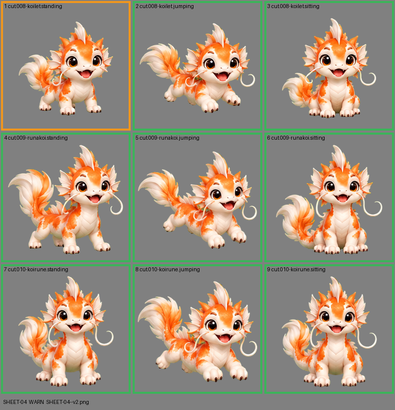

# SHEET-04: Mascot family (3 stages x 3 poses): Koilet, Runakoi, Koirune

- File: `wildkin-production/incoming/SHEET-04--v2.png`
- sha256: `d2aada4976072abdd71a5347faeb76c056a7b1cd56e43aea797f12d3337697d2`
- Checked: 2026-10-13T16:53:50Z
- Result: **warn**

## Warnings (need a human look)

- cell 1: 1 stray mark(s) removed ("!" bursts, sparkles); check the piece

| Cell | Asset | Result |
|---|---|---|
| 1 | cut.008-koilet.standing | 1 stray mark(s) removed ("!" bursts, sparkles); check the piece |
| 2 | cut.008-koilet.jumping | ok |
| 3 | cut.008-koilet.sitting | ok |
| 4 | cut.009-runakoi.standing | ok |
| 5 | cut.009-runakoi.jumping | ok |
| 6 | cut.009-runakoi.sitting | ok |
| 7 | cut.010-koirune.standing | ok |
| 8 | cut.010-koirune.jumping | ok |
| 9 | cut.010-koirune.sitting | ok |
