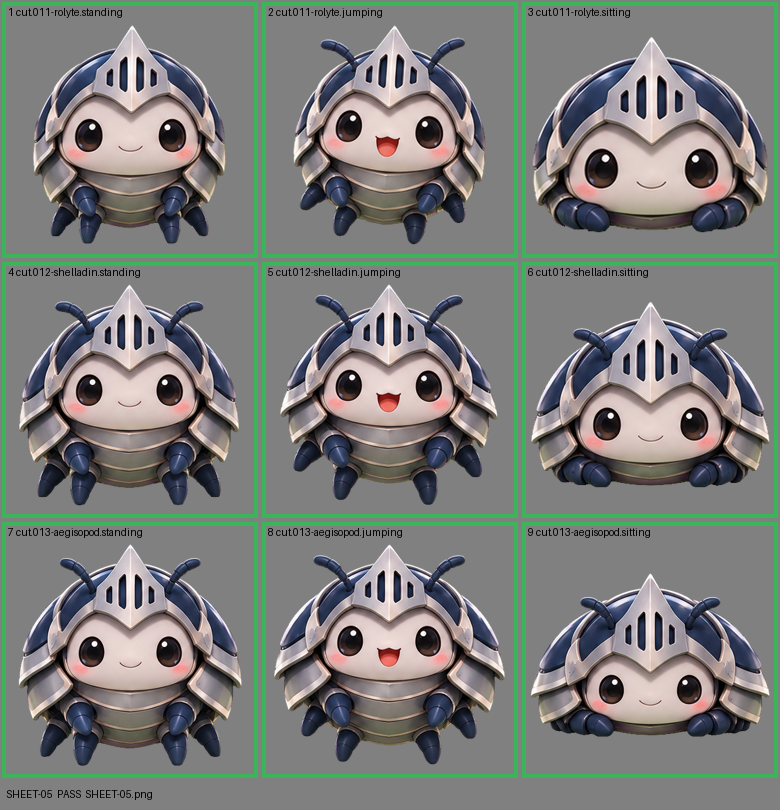

# SHEET-05: Mascot family (3 stages x 3 poses): Rolyte, Shelladin, Aegisopod

- File: `wildkin-production/incoming/SHEET-05.png`
- sha256: `7a4f56f95d9f40c1180e8b51aa990ce90e9dce893a5c89bea2180a038b4fbfdf`
- Checked: 2026-10-14T01:43:53Z
- Result: **pass**

## Notes (do not block)

- cell 7: margin is tight (10 px); the spec asks for about 10%
- cell 8: margin is tight (5 px); the spec asks for about 10%
- cell 9: margin is tight (8 px); the spec asks for about 10%

| Cell | Asset | Result |
|---|---|---|
| 1 | cut.011-rolyte.standing | ok |
| 2 | cut.011-rolyte.jumping | ok |
| 3 | cut.011-rolyte.sitting | ok |
| 4 | cut.012-shelladin.standing | ok |
| 5 | cut.012-shelladin.jumping | ok |
| 6 | cut.012-shelladin.sitting | ok |
| 7 | cut.013-aegisopod.standing | ok |
| 8 | cut.013-aegisopod.jumping | ok |
| 9 | cut.013-aegisopod.sitting | ok |
