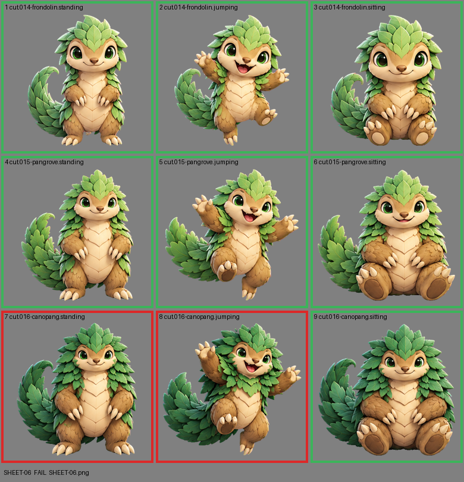

# SHEET-06: Mascot family (3 stages x 3 poses): Frondolin, Pangrove, Canopang

- File: `wildkin-production/incoming/SHEET-06.png`
- sha256: `35ed36e896c89ba19ae1a62c03b4223588bfcf1fffec1a4db3f52777b5b9a281`
- Checked: 2026-10-13T15:32:29Z
- Result: **fail**

## Errors (block approval)

- cell 7: subject touches the cell edge (clipped): top
- cell 8: subject touches the cell edge (clipped): top

## Notes (do not block)

- cell 4: margin is tight (8 px); the spec asks for about 10%
- cell 5: margin is tight (10 px); the spec asks for about 10%
- cell 9: margin is tight (7 px); the spec asks for about 10%

| Cell | Asset | Result |
|---|---|---|
| 1 | cut.014-frondolin.standing | ok |
| 2 | cut.014-frondolin.jumping | ok |
| 3 | cut.014-frondolin.sitting | ok |
| 4 | cut.015-pangrove.standing | ok |
| 5 | cut.015-pangrove.jumping | ok |
| 6 | cut.015-pangrove.sitting | ok |
| 7 | cut.016-canopang.standing | subject touches the cell edge (clipped): top |
| 8 | cut.016-canopang.jumping | subject touches the cell edge (clipped): top |
| 9 | cut.016-canopang.sitting | ok |
