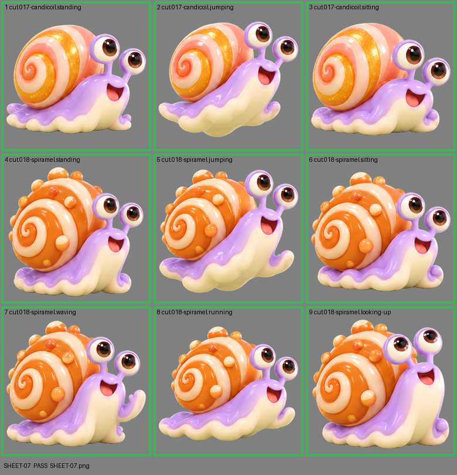

# SHEET-07: Mascot family (2 stages, 9 cells): Candicoil, Spiramel

- File: `wildkin-production/incoming/SHEET-07.png`
- sha256: `194a669ab664f395c4e40b79783ded6cf45abafeb1ba6986f6fdfc7d00973b5a`
- Checked: 2026-10-14T01:44:26Z
- Result: **pass**

## Notes (do not block)

- cell 1: margin is tight (14 px); the spec asks for about 10%
- cell 4: margin is tight (13 px); the spec asks for about 10%
- cell 8: margin is tight (10 px); the spec asks for about 10%

| Cell | Asset | Result |
|---|---|---|
| 1 | cut.017-candicoil.standing | ok |
| 2 | cut.017-candicoil.jumping | ok |
| 3 | cut.017-candicoil.sitting | ok |
| 4 | cut.018-spiramel.standing | ok |
| 5 | cut.018-spiramel.jumping | ok |
| 6 | cut.018-spiramel.sitting | ok |
| 7 | cut.018-spiramel.waving | ok |
| 8 | cut.018-spiramel.running | ok |
| 9 | cut.018-spiramel.looking-up | ok |
