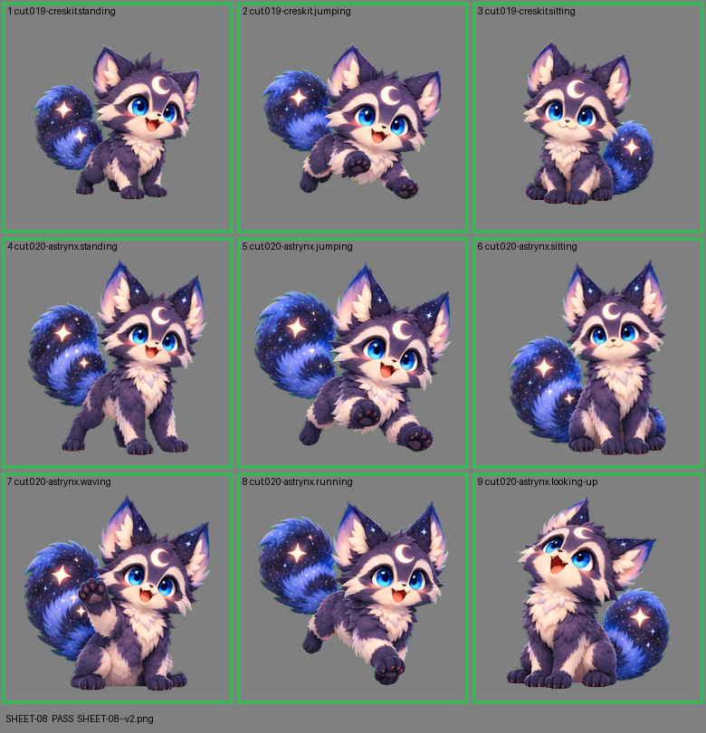

# SHEET-08: Mascot family (2 stages, 9 cells): Creskit, Astrynx

- File: `wildkin-production/incoming/SHEET-08--v2.png`
- sha256: `c4e1ea253781c501fb53b57a897328d9c89e44fea8df2c1ccce95ccd61bbaf64`
- Checked: 2026-10-13T16:54:00Z
- Result: **pass**

| Cell | Asset | Result |
|---|---|---|
| 1 | cut.019-creskit.standing | ok |
| 2 | cut.019-creskit.jumping | ok |
| 3 | cut.019-creskit.sitting | ok |
| 4 | cut.020-astrynx.standing | ok |
| 5 | cut.020-astrynx.jumping | ok |
| 6 | cut.020-astrynx.sitting | ok |
| 7 | cut.020-astrynx.waving | ok |
| 8 | cut.020-astrynx.running | ok |
| 9 | cut.020-astrynx.looking-up | ok |
