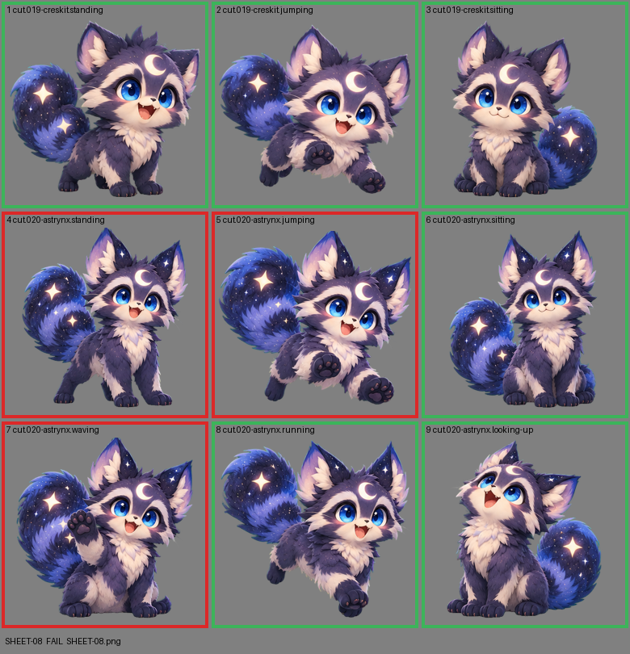

# SHEET-08: Mascot family (2 stages, 9 cells): Creskit, Astrynx

- File: `wildkin-production/incoming/SHEET-08.png`
- sha256: `d778b779143a36ce27f1b95922e2eff04a1bf814a0b0a94c56f588cf74e63a82`
- Checked: 2026-10-13T15:21:48Z
- Result: **fail**

## Errors (block approval)

- cell 4: subject touches the cell edge (clipped): top
- cell 5: subject touches the cell edge (clipped): top
- cell 7: subject touches the cell edge (clipped): top

## Notes (do not block)

- cell 6: margin is tight (10 px); the spec asks for about 10%
- cell 8: margin is tight (7 px); the spec asks for about 10%
- cell 9: margin is tight (7 px); the spec asks for about 10%

| Cell | Asset | Result |
|---|---|---|
| 1 | cut.019-creskit.standing | ok |
| 2 | cut.019-creskit.jumping | ok |
| 3 | cut.019-creskit.sitting | ok |
| 4 | cut.020-astrynx.standing | subject touches the cell edge (clipped): top |
| 5 | cut.020-astrynx.jumping | subject touches the cell edge (clipped): top |
| 6 | cut.020-astrynx.sitting | ok |
| 7 | cut.020-astrynx.waving | subject touches the cell edge (clipped): top |
| 8 | cut.020-astrynx.running | ok |
| 9 | cut.020-astrynx.looking-up | ok |
