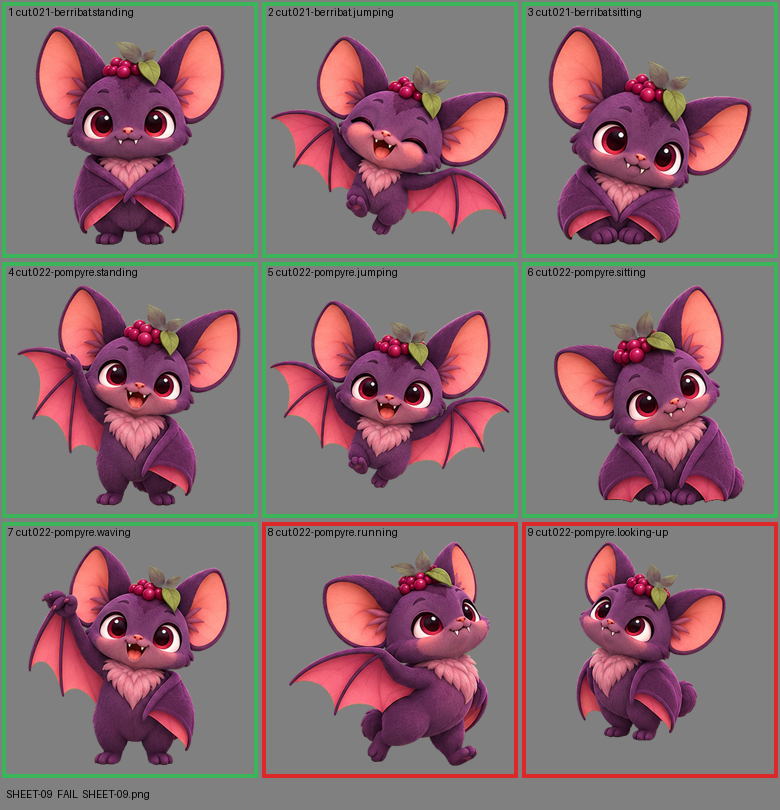

# SHEET-09: Mascot family (2 stages, 9 cells): Berribat, Pompyre

- File: `wildkin-production/incoming/SHEET-09.png`
- sha256: `c227d3b38fe483ae1f06fe89e99616ce0ed8f4d1a65fbaf2e451ea799ea1f254`
- Checked: 2026-10-14T01:45:24Z
- Result: **fail**

## Errors (block approval)

- cell 8: subject touches the cell edge (clipped): top
- cell 9: subject touches the cell edge (clipped): top

## Notes (do not block)

- cell 2: margin is tight (14 px); the spec asks for about 10%
- cell 4: margin is tight (5 px); the spec asks for about 10%
- cell 5: margin is tight (3 px); the spec asks for about 10%
- cell 6: margin is tight (10 px); the spec asks for about 10%
- cell 7: margin is tight (6 px); the spec asks for about 10%

| Cell | Asset | Result |
|---|---|---|
| 1 | cut.021-berribat.standing | ok |
| 2 | cut.021-berribat.jumping | ok |
| 3 | cut.021-berribat.sitting | ok |
| 4 | cut.022-pompyre.standing | ok |
| 5 | cut.022-pompyre.jumping | ok |
| 6 | cut.022-pompyre.sitting | ok |
| 7 | cut.022-pompyre.waving | ok |
| 8 | cut.022-pompyre.running | subject touches the cell edge (clipped): top |
| 9 | cut.022-pompyre.looking-up | subject touches the cell edge (clipped): top |
