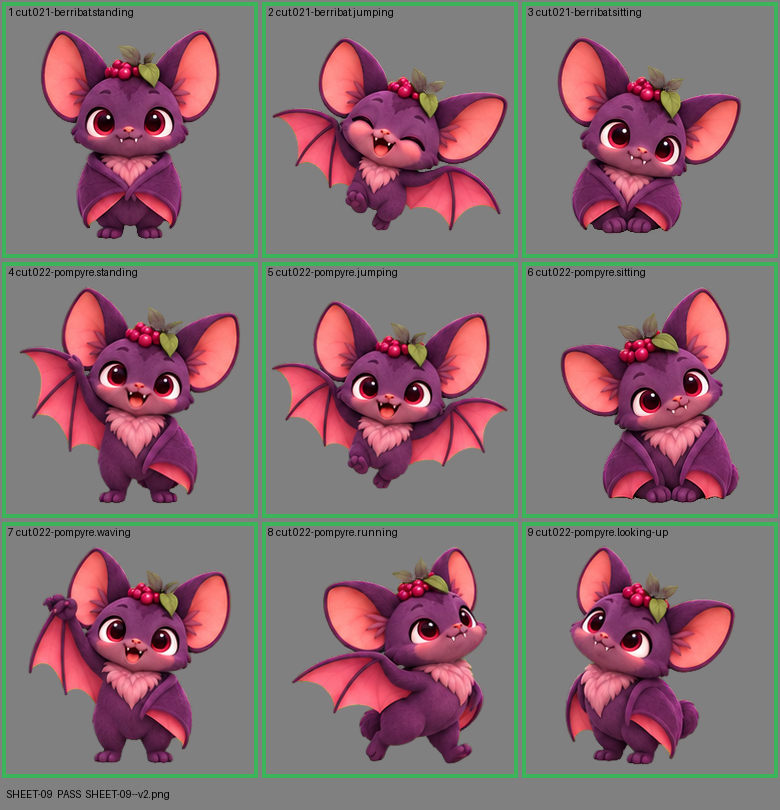

# SHEET-09: Mascot family (2 stages, 9 cells): Berribat, Pompyre

- File: `wildkin-production/incoming/SHEET-09--v2.png`
- sha256: `f508aee453494ced32a9ddbdf58344d4e50cd6c65ce2946714e571696b7bbf33`
- Checked: 2026-10-14T01:45:16Z
- Result: **pass**

| Cell | Asset | Result |
|---|---|---|
| 1 | cut.021-berribat.standing | ok |
| 2 | cut.021-berribat.jumping | ok |
| 3 | cut.021-berribat.sitting | ok |
| 4 | cut.022-pompyre.standing | ok |
| 5 | cut.022-pompyre.jumping | ok |
| 6 | cut.022-pompyre.sitting | ok |
| 7 | cut.022-pompyre.waving | ok |
| 8 | cut.022-pompyre.running | ok |
| 9 | cut.022-pompyre.looking-up | ok |
