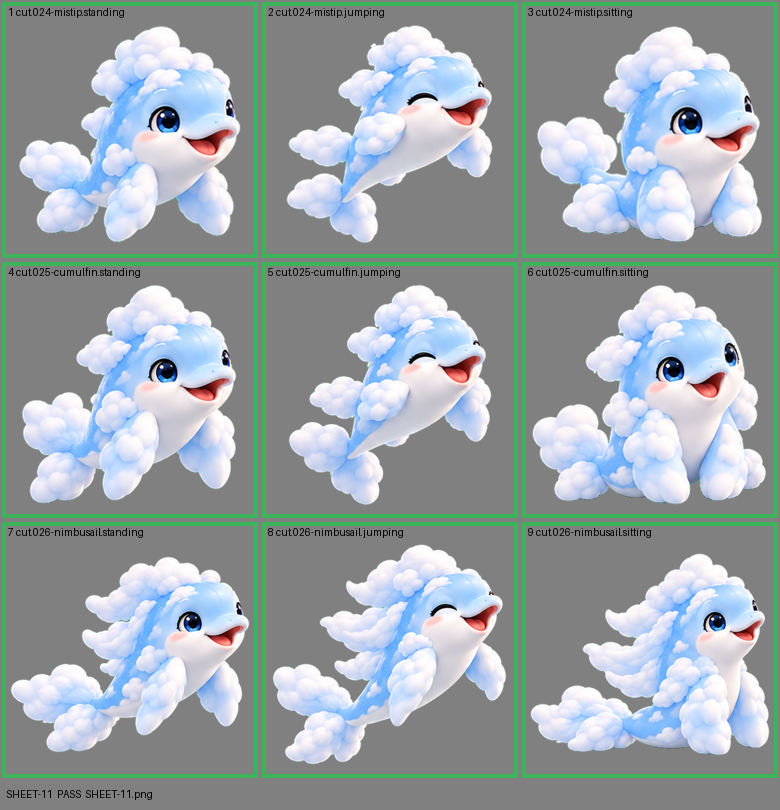

# SHEET-11: Evolution family (3 stages x 3 poses): Mistip, Cumulfin, Nimbusail

- File: `wildkin-production/incoming/SHEET-11.png`
- sha256: `b00351a7f6d28988c797105968bc55a4ee219df891975393d86302d7183ab340`
- Checked: 2026-10-13T15:32:53Z
- Result: **pass**

| Cell | Asset | Result |
|---|---|---|
| 1 | cut.024-mistip.standing | ok |
| 2 | cut.024-mistip.jumping | ok |
| 3 | cut.024-mistip.sitting | ok |
| 4 | cut.025-cumulfin.standing | ok |
| 5 | cut.025-cumulfin.jumping | ok |
| 6 | cut.025-cumulfin.sitting | ok |
| 7 | cut.026-nimbusail.standing | ok |
| 8 | cut.026-nimbusail.jumping | ok |
| 9 | cut.026-nimbusail.sitting | ok |
