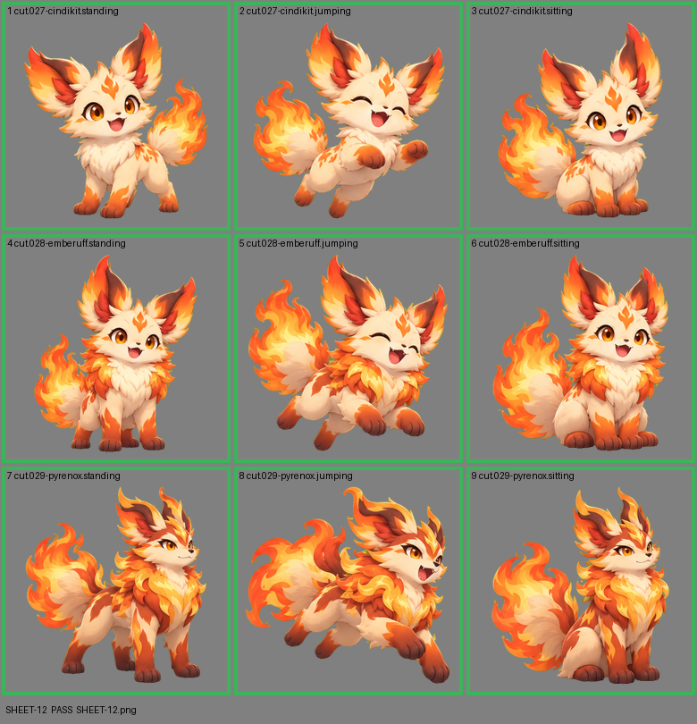

# SHEET-12: Evolution family (3 stages x 3 poses): Cindikit, Emberuff, Pyrenox

- File: `wildkin-production/incoming/SHEET-12.png`
- sha256: `2b2afec0f21cff589aa04a3785d09d35d887d9cb264dc4bcaa01ae60c66fdb6f`
- Checked: 2026-10-14T01:45:58Z
- Result: **pass**

## Notes (do not block)

- cell 7: margin is tight (9 px); the spec asks for about 10%
- cell 8: margin is tight (9 px); the spec asks for about 10%
- cell 9: margin is tight (8 px); the spec asks for about 10%

| Cell | Asset | Result |
|---|---|---|
| 1 | cut.027-cindikit.standing | ok |
| 2 | cut.027-cindikit.jumping | ok |
| 3 | cut.027-cindikit.sitting | ok |
| 4 | cut.028-emberuff.standing | ok |
| 5 | cut.028-emberuff.jumping | ok |
| 6 | cut.028-emberuff.sitting | ok |
| 7 | cut.029-pyrenox.standing | ok |
| 8 | cut.029-pyrenox.jumping | ok |
| 9 | cut.029-pyrenox.sitting | ok |
