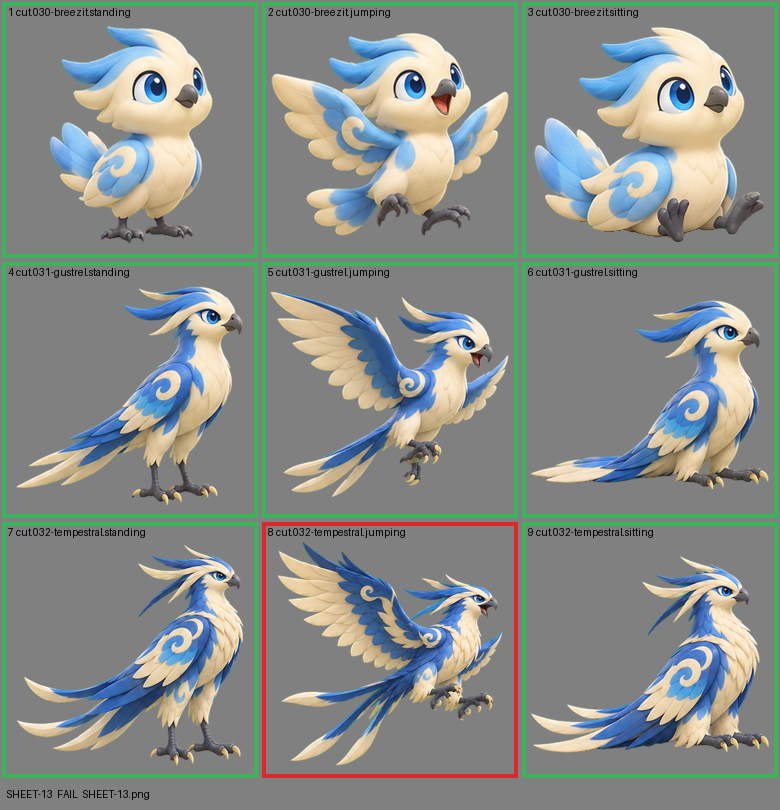

# SHEET-13: Evolution family (3 stages x 3 poses): Breezit, Gustrel, Tempestral

- File: `wildkin-production/incoming/SHEET-13.png`
- sha256: `dbccc5293c758880a6191ec346f1c270d5310c855daa8f8470d1b1e9db5e7045`
- Checked: 2026-10-13T15:33:16Z
- Result: **fail**

## Errors (block approval)

- cell 8: subject touches the cell edge (clipped): top

## Notes (do not block)

- cell 7: margin is tight (10 px); the spec asks for about 10%

| Cell | Asset | Result |
|---|---|---|
| 1 | cut.030-breezit.standing | ok |
| 2 | cut.030-breezit.jumping | ok |
| 3 | cut.030-breezit.sitting | ok |
| 4 | cut.031-gustrel.standing | ok |
| 5 | cut.031-gustrel.jumping | ok |
| 6 | cut.031-gustrel.sitting | ok |
| 7 | cut.032-tempestral.standing | ok |
| 8 | cut.032-tempestral.jumping | subject touches the cell edge (clipped): top |
| 9 | cut.032-tempestral.sitting | ok |
