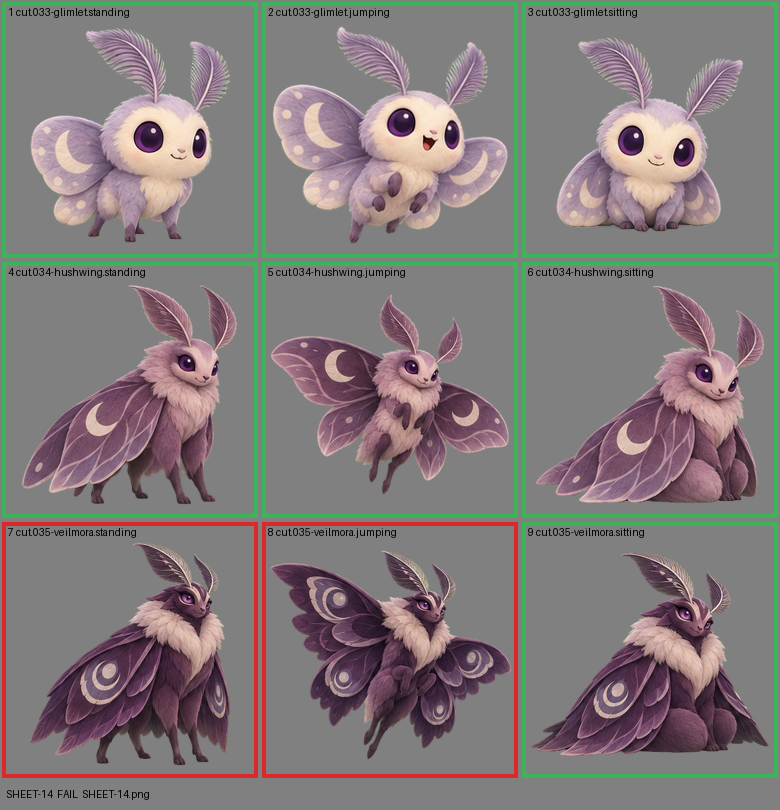

# SHEET-14: Evolution family (3 stages x 3 poses): Glimlet, Hushwing, Veilmora

- File: `wildkin-production/incoming/SHEET-14.png`
- sha256: `e82dcd61e96bee0762e7f26050e0d36a6efcfe203a668b9f2e7bf356a374e28c`
- Checked: 2026-10-14T01:46:48Z
- Result: **fail**

## Errors (block approval)

- cell 7: subject touches the cell edge (clipped): top
- cell 8: subject touches the cell edge (clipped): right

## Notes (do not block)

- cell 5: margin is tight (7 px); the spec asks for about 10%
- cell 9: margin is tight (10 px); the spec asks for about 10%

| Cell | Asset | Result |
|---|---|---|
| 1 | cut.033-glimlet.standing | ok |
| 2 | cut.033-glimlet.jumping | ok |
| 3 | cut.033-glimlet.sitting | ok |
| 4 | cut.034-hushwing.standing | ok |
| 5 | cut.034-hushwing.jumping | ok |
| 6 | cut.034-hushwing.sitting | ok |
| 7 | cut.035-veilmora.standing | subject touches the cell edge (clipped): top |
| 8 | cut.035-veilmora.jumping | subject touches the cell edge (clipped): right |
| 9 | cut.035-veilmora.sitting | ok |
