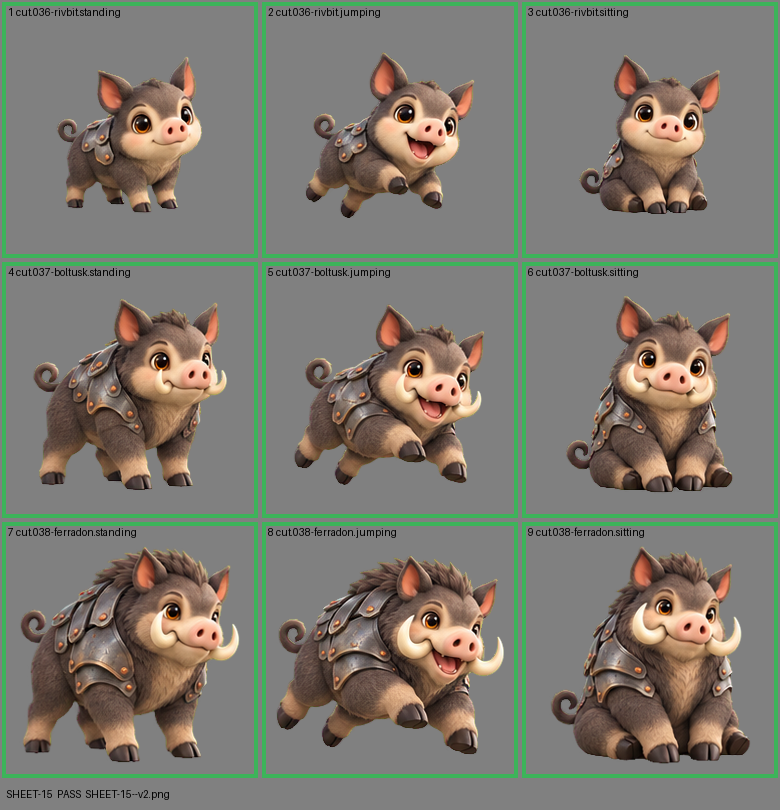

# SHEET-15: Evolution family (3 stages x 3 poses): Rivbit, Boltusk, Ferradon

- File: `wildkin-production/incoming/SHEET-15--v2.png`
- sha256: `b802f1db78d837f750b152076d5450f4b847e0347109dab07a34b9380aa31326`
- Checked: 2026-10-15T05:45:12Z
- Result: **pass**

| Cell | Asset | Result |
|---|---|---|
| 1 | cut.036-rivbit.standing | ok |
| 2 | cut.036-rivbit.jumping | ok |
| 3 | cut.036-rivbit.sitting | ok |
| 4 | cut.037-boltusk.standing | ok |
| 5 | cut.037-boltusk.jumping | ok |
| 6 | cut.037-boltusk.sitting | ok |
| 7 | cut.038-ferradon.standing | ok |
| 8 | cut.038-ferradon.jumping | ok |
| 9 | cut.038-ferradon.sitting | ok |
