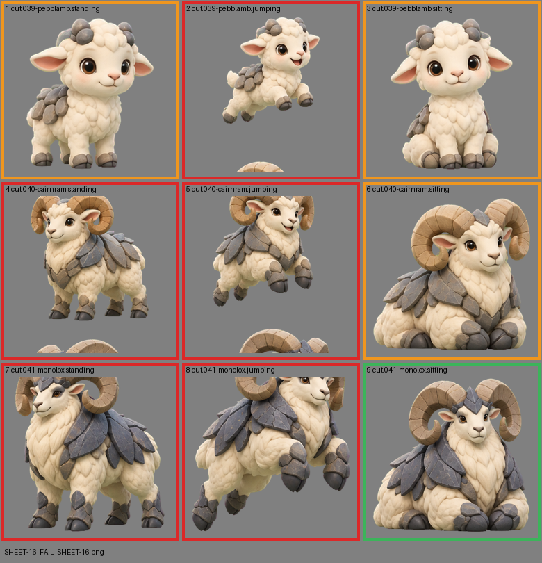

# SHEET-16: Evolution family (3 stages x 3 poses): Pebblamb, Cairnram, Monolox

- File: `wildkin-production/incoming/SHEET-16.png`
- sha256: `0a2398d67307a58c9c576b21e2b7eec08ac1580694a91bb265889933726470bf`
- Checked: 2026-10-14T01:47:20Z
- Result: **fail**

## Errors (block approval)

- cell 2: subject touches the cell edge (clipped): bottom
- cell 4: subject touches the cell edge (clipped): top+bottom
- cell 5: subject touches the cell edge (clipped): top+bottom
- cell 7: subject touches the cell edge (clipped): top
- cell 8: subject touches the cell edge (clipped): top

## Warnings (need a human look)

- cell 1: 10 stray mark(s) removed ("!" bursts, sparkles); check the piece
- cell 2: 3 stray mark(s) removed ("!" bursts, sparkles); check the piece
- cell 3: 2 stray mark(s) removed ("!" bursts, sparkles); check the piece
- cell 4: 13 stray mark(s) removed ("!" bursts, sparkles); check the piece
- cell 5: 12 stray mark(s) removed ("!" bursts, sparkles); check the piece
- cell 6: 13 stray mark(s) removed ("!" bursts, sparkles); check the piece

## Notes (do not block)

- cell 6: margin is tight (14 px); the spec asks for about 10%
- cell 9: margin is tight (8 px); the spec asks for about 10%

| Cell | Asset | Result |
|---|---|---|
| 1 | cut.039-pebblamb.standing | 10 stray mark(s) removed ("!" bursts, sparkles); check the piece |
| 2 | cut.039-pebblamb.jumping | subject touches the cell edge (clipped): bottom; 3 stray mark(s) removed ("!" bursts, sparkles); check the piece |
| 3 | cut.039-pebblamb.sitting | 2 stray mark(s) removed ("!" bursts, sparkles); check the piece |
| 4 | cut.040-cairnram.standing | subject touches the cell edge (clipped): top+bottom; 13 stray mark(s) removed ("!" bursts, sparkles); check the piece |
| 5 | cut.040-cairnram.jumping | subject touches the cell edge (clipped): top+bottom; 12 stray mark(s) removed ("!" bursts, sparkles); check the piece |
| 6 | cut.040-cairnram.sitting | 13 stray mark(s) removed ("!" bursts, sparkles); check the piece |
| 7 | cut.041-monolox.standing | subject touches the cell edge (clipped): top |
| 8 | cut.041-monolox.jumping | subject touches the cell edge (clipped): top |
| 9 | cut.041-monolox.sitting | ok |
