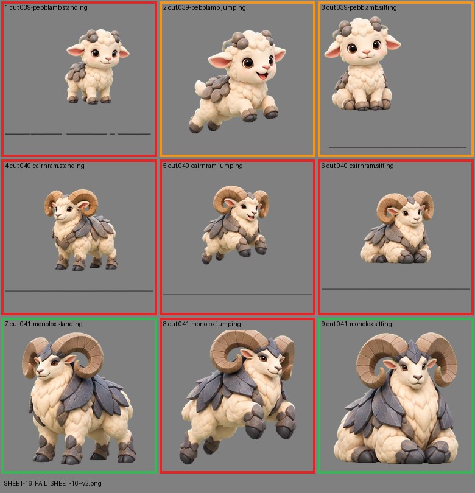

# SHEET-16: Evolution family (3 stages x 3 poses): Pebblamb, Cairnram, Monolox

- File: `wildkin-production/incoming/SHEET-16--v2.png`
- sha256: `6663cd3f213ce9560a6884f34984c9a27532ab7f9bd412566eedfacc8159982e`
- Checked: 2026-10-14T01:47:07Z
- Result: **fail**

## Errors (block approval)

- cell 1: subject touches the cell edge (clipped): left
- cell 4: subject touches the cell edge (clipped): left+right
- cell 5: subject touches the cell edge (clipped): left+right
- cell 6: subject touches the cell edge (clipped): left+right
- cell 8: subject touches the cell edge (clipped): top

## Warnings (need a human look)

- cell 1: 2 stray mark(s) removed ("!" bursts, sparkles); check the piece
- cell 2: 5 stray mark(s) removed ("!" bursts, sparkles); check the piece
- cell 3: 2 stray mark(s) removed ("!" bursts, sparkles); check the piece

## Notes (do not block)

- cell 3: margin is tight (7 px); the spec asks for about 10%
- cell 7: margin is tight (15 px); the spec asks for about 10%

| Cell | Asset | Result |
|---|---|---|
| 1 | cut.039-pebblamb.standing | subject touches the cell edge (clipped): left; 2 stray mark(s) removed ("!" bursts, sparkles); check the piece |
| 2 | cut.039-pebblamb.jumping | 5 stray mark(s) removed ("!" bursts, sparkles); check the piece |
| 3 | cut.039-pebblamb.sitting | 2 stray mark(s) removed ("!" bursts, sparkles); check the piece |
| 4 | cut.040-cairnram.standing | subject touches the cell edge (clipped): left+right |
| 5 | cut.040-cairnram.jumping | subject touches the cell edge (clipped): left+right |
| 6 | cut.040-cairnram.sitting | subject touches the cell edge (clipped): left+right |
| 7 | cut.041-monolox.standing | ok |
| 8 | cut.041-monolox.jumping | subject touches the cell edge (clipped): top |
| 9 | cut.041-monolox.sitting | ok |
