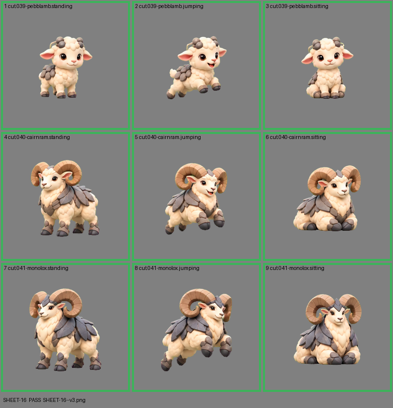

# SHEET-16: Evolution family (3 stages x 3 poses): Pebblamb, Cairnram, Monolox

- File: `wildkin-production/incoming/SHEET-16--v3.png`
- sha256: `da02df5dd9038f52bc4f920085dc0f53e5bee30606a2d9238b8b66c7b49fcfd4`
- Checked: 2026-10-15T05:45:21Z
- Result: **pass**

| Cell | Asset | Result |
|---|---|---|
| 1 | cut.039-pebblamb.standing | ok |
| 2 | cut.039-pebblamb.jumping | ok |
| 3 | cut.039-pebblamb.sitting | ok |
| 4 | cut.040-cairnram.standing | ok |
| 5 | cut.040-cairnram.jumping | ok |
| 6 | cut.040-cairnram.sitting | ok |
| 7 | cut.041-monolox.standing | ok |
| 8 | cut.041-monolox.jumping | ok |
| 9 | cut.041-monolox.sitting | ok |
