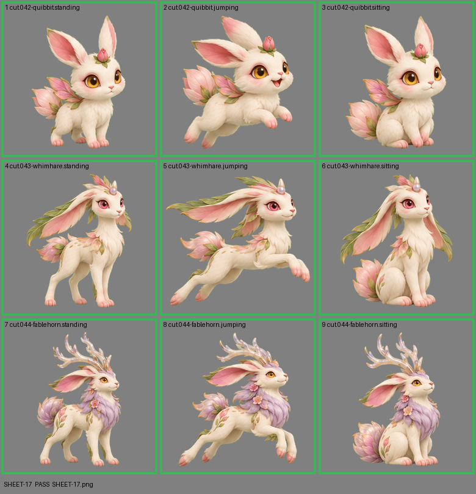

# SHEET-17: Evolution family (3 stages x 3 poses): Quibbit, Whimhare, Fablehorn

- File: `wildkin-production/incoming/SHEET-17.png`
- sha256: `6af4484bb2de489574542ed2c9218c69842c6d1dfd1cc7b3b05d1dd2d3b75eee`
- Checked: 2026-10-13T15:46:18Z
- Result: **pass**

## Notes (do not block)

- cell 7: margin is tight (13 px); the spec asks for about 10%
- cell 8: margin is tight (7 px); the spec asks for about 10%

| Cell | Asset | Result |
|---|---|---|
| 1 | cut.042-quibbit.standing | ok |
| 2 | cut.042-quibbit.jumping | ok |
| 3 | cut.042-quibbit.sitting | ok |
| 4 | cut.043-whimhare.standing | ok |
| 5 | cut.043-whimhare.jumping | ok |
| 6 | cut.043-whimhare.sitting | ok |
| 7 | cut.044-fablehorn.standing | ok |
| 8 | cut.044-fablehorn.jumping | ok |
| 9 | cut.044-fablehorn.sitting | ok |
