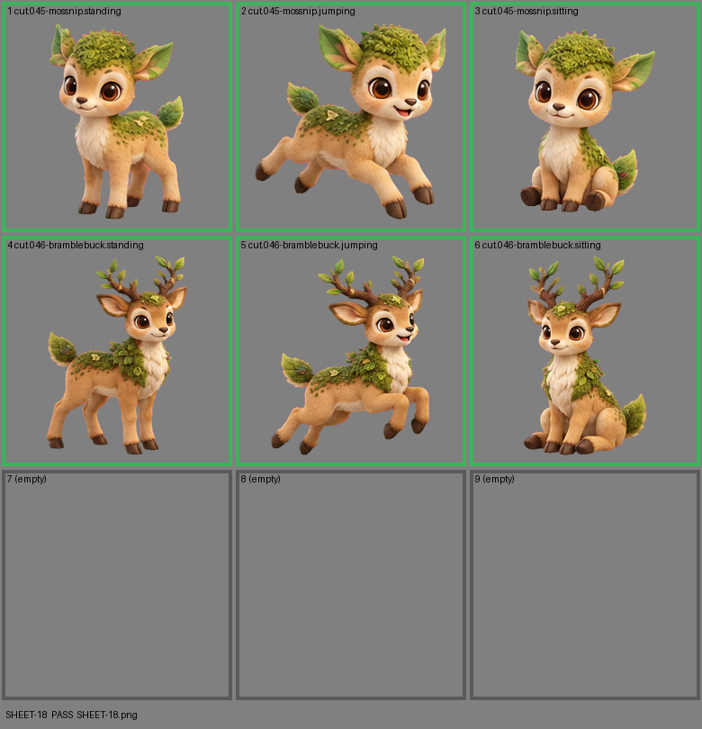

# SHEET-18: Evolution family (2 stages x 3 poses, 3 cells empty): Mossnip, Bramblebuck

- File: `wildkin-production/incoming/SHEET-18.png`
- sha256: `5c443d8f938d10b135996f264e2ab7a1ae117464d21ac27d1af514b99312bfef`
- Checked: 2026-10-13T15:46:28Z
- Result: **pass**

## Notes (do not block)

- cell 4: margin is tight (11 px); the spec asks for about 10%
- cell 5: margin is tight (7 px); the spec asks for about 10%

| Cell | Asset | Result |
|---|---|---|
| 1 | cut.045-mossnip.standing | ok |
| 2 | cut.045-mossnip.jumping | ok |
| 3 | cut.045-mossnip.sitting | ok |
| 4 | cut.046-bramblebuck.standing | ok |
| 5 | cut.046-bramblebuck.jumping | ok |
| 6 | cut.046-bramblebuck.sitting | ok |
| 7 | (empty) | empty as asked |
| 8 | (empty) | empty as asked |
| 9 | (empty) | empty as asked |
