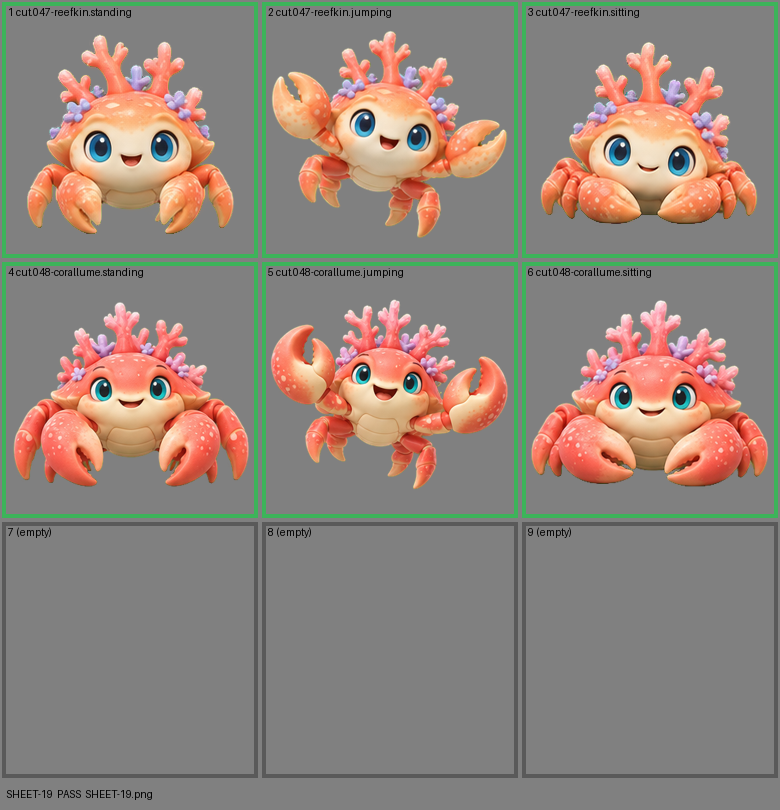

# SHEET-19: Evolution family (2 stages x 3 poses, 3 cells empty): Reefkin, Corallume

- File: `wildkin-production/incoming/SHEET-19.png`
- sha256: `cee9691b7fa7eb020f538df534faeb550f352380dbc28c1b2a844334366a722c`
- Checked: 2026-10-13T15:46:33Z
- Result: **pass**

## Notes (do not block)

- cell 5: margin is tight (14 px); the spec asks for about 10%

| Cell | Asset | Result |
|---|---|---|
| 1 | cut.047-reefkin.standing | ok |
| 2 | cut.047-reefkin.jumping | ok |
| 3 | cut.047-reefkin.sitting | ok |
| 4 | cut.048-corallume.standing | ok |
| 5 | cut.048-corallume.jumping | ok |
| 6 | cut.048-corallume.sitting | ok |
| 7 | (empty) | empty as asked |
| 8 | (empty) | empty as asked |
| 9 | (empty) | empty as asked |
