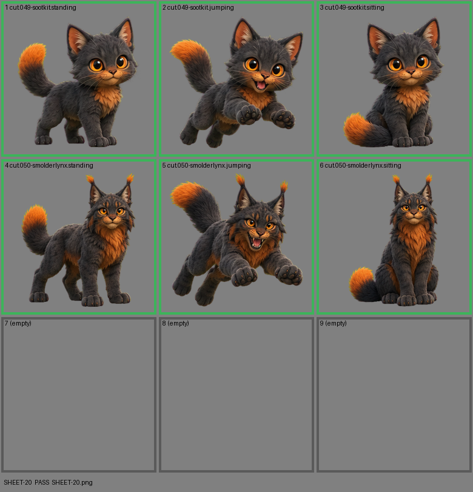

# SHEET-20: Evolution family (2 stages x 3 poses, 3 cells empty): Sootkit, Smolderlynx

- File: `wildkin-production/incoming/SHEET-20.png`
- sha256: `9b30515ffb1ee5a2f46eb2870f6d44005c06c4fdc8389981478a7f16d910714f`
- Checked: 2026-10-13T15:46:38Z
- Result: **pass**

## Notes (do not block)

- cell 4: margin is tight (8 px); the spec asks for about 10%
- cell 6: margin is tight (7 px); the spec asks for about 10%

| Cell | Asset | Result |
|---|---|---|
| 1 | cut.049-sootkit.standing | ok |
| 2 | cut.049-sootkit.jumping | ok |
| 3 | cut.049-sootkit.sitting | ok |
| 4 | cut.050-smolderlynx.standing | ok |
| 5 | cut.050-smolderlynx.jumping | ok |
| 6 | cut.050-smolderlynx.sitting | ok |
| 7 | (empty) | empty as asked |
| 8 | (empty) | empty as asked |
| 9 | (empty) | empty as asked |
