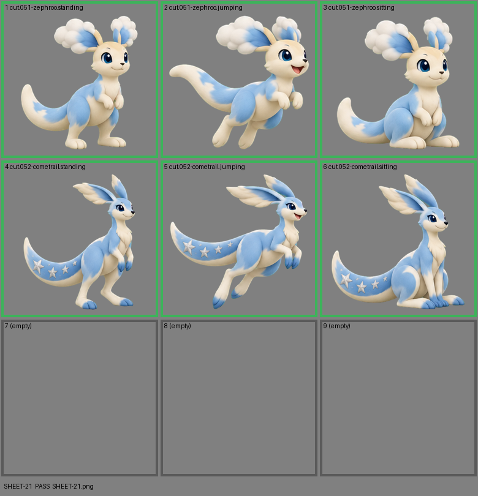

# SHEET-21: Evolution family (2 stages x 3 poses, 3 cells empty): Zephroo, Cometrail

- File: `wildkin-production/incoming/SHEET-21.png`
- sha256: `df8aa8645fdfd67ec687c51f94080f16961a8c185b5b9ba900a6fd30c6b600eb`
- Checked: 2026-10-14T01:48:14Z
- Result: **pass**

## Notes (do not block)

- cell 4: margin is tight (13 px); the spec asks for about 10%
- cell 5: margin is tight (8 px); the spec asks for about 10%
- cell 6: margin is tight (14 px); the spec asks for about 10%

| Cell | Asset | Result |
|---|---|---|
| 1 | cut.051-zephroo.standing | ok |
| 2 | cut.051-zephroo.jumping | ok |
| 3 | cut.051-zephroo.sitting | ok |
| 4 | cut.052-cometrail.standing | ok |
| 5 | cut.052-cometrail.jumping | ok |
| 6 | cut.052-cometrail.sitting | ok |
| 7 | (empty) | empty as asked |
| 8 | (empty) | empty as asked |
| 9 | (empty) | empty as asked |
