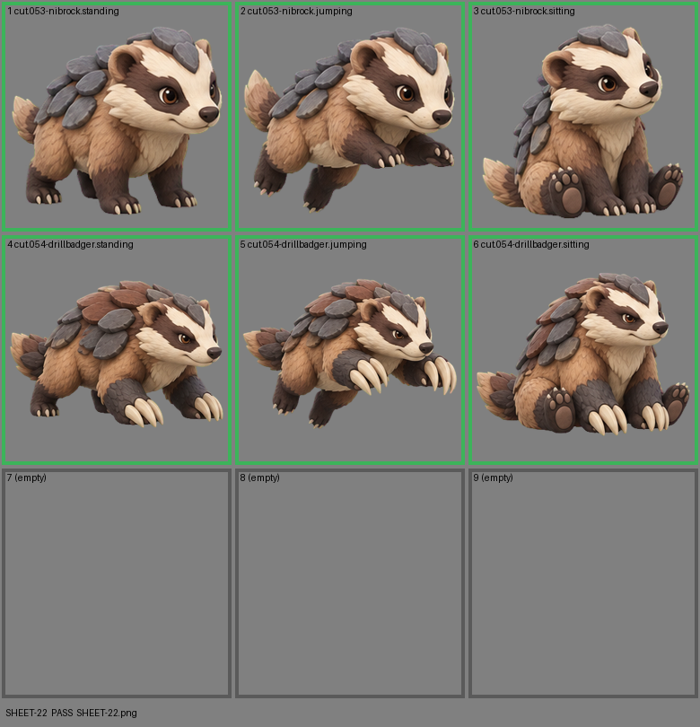

# SHEET-22: Evolution family (2 stages x 3 poses, 3 cells empty): Nibrock, Drillbadger

- File: `wildkin-production/incoming/SHEET-22.png`
- sha256: `55bf586d92fb4d651dcf3843ba17f75a1cacbcdc50a69c72ddf60b5f9a16bae6`
- Checked: 2026-10-13T15:46:58Z
- Result: **pass**

## Notes (do not block)

- cell 5: margin is tight (11 px); the spec asks for about 10%

| Cell | Asset | Result |
|---|---|---|
| 1 | cut.053-nibrock.standing | ok |
| 2 | cut.053-nibrock.jumping | ok |
| 3 | cut.053-nibrock.sitting | ok |
| 4 | cut.054-drillbadger.standing | ok |
| 5 | cut.054-drillbadger.jumping | ok |
| 6 | cut.054-drillbadger.sitting | ok |
| 7 | (empty) | empty as asked |
| 8 | (empty) | empty as asked |
| 9 | (empty) | empty as asked |
