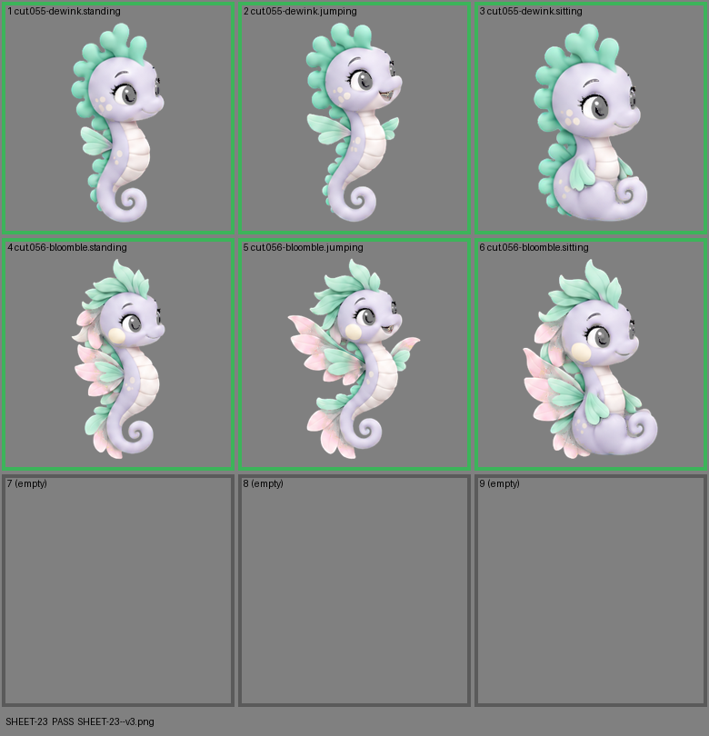

# SHEET-23: Evolution family (2 stages x 3 poses, 3 cells empty): Dewink, Bloomble

- File: `wildkin-production/incoming/SHEET-23--v3.png`
- sha256: `a4b44a41ec6ac441870503a8ea8eba868835c9547155a1b56c245f28f68826bf`
- Checked: 2026-10-15T05:45:27Z
- Result: **pass**

## Notes (do not block)

- cell 5: margin is tight (14 px); the spec asks for about 10%

| Cell | Asset | Result |
|---|---|---|
| 1 | cut.055-dewink.standing | ok |
| 2 | cut.055-dewink.jumping | ok |
| 3 | cut.055-dewink.sitting | ok |
| 4 | cut.056-bloomble.standing | ok |
| 5 | cut.056-bloomble.jumping | ok |
| 6 | cut.056-bloomble.sitting | ok |
| 7 | (empty) | empty as asked |
| 8 | (empty) | empty as asked |
| 9 | (empty) | empty as asked |
