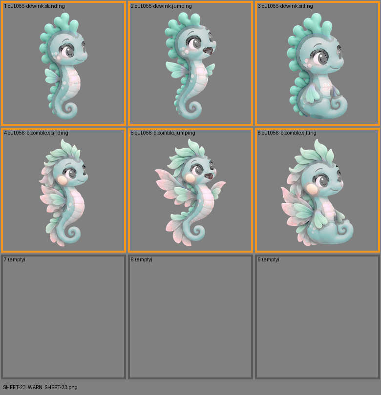

# SHEET-23: Evolution family (2 stages x 3 poses, 3 cells empty): Dewink, Bloomble

- File: `wildkin-production/incoming/SHEET-23.png`
- sha256: `b627e40c42e17cefcad083aa690222b50407d6bdc9ffc7b7485046ddadef9554`
- Checked: 2026-10-14T01:48:37Z
- Result: **warn**

## Warnings (need a human look)

- cell 1: a lot of half-transparent pixels (62%): soft edges or a glow on the screen
- cell 2: a lot of half-transparent pixels (61%): soft edges or a glow on the screen
- cell 3: a lot of half-transparent pixels (62%): soft edges or a glow on the screen
- cell 4: a lot of half-transparent pixels (62%): soft edges or a glow on the screen
- cell 5: a lot of half-transparent pixels (56%): soft edges or a glow on the screen
- cell 6: a lot of half-transparent pixels (62%): soft edges or a glow on the screen

| Cell | Asset | Result |
|---|---|---|
| 1 | cut.055-dewink.standing | a lot of half-transparent pixels (62%): soft edges or a glow on the screen |
| 2 | cut.055-dewink.jumping | a lot of half-transparent pixels (61%): soft edges or a glow on the screen |
| 3 | cut.055-dewink.sitting | a lot of half-transparent pixels (62%): soft edges or a glow on the screen |
| 4 | cut.056-bloomble.standing | a lot of half-transparent pixels (62%): soft edges or a glow on the screen |
| 5 | cut.056-bloomble.jumping | a lot of half-transparent pixels (56%): soft edges or a glow on the screen |
| 6 | cut.056-bloomble.sitting | a lot of half-transparent pixels (62%): soft edges or a glow on the screen |
| 7 | (empty) | empty as asked |
| 8 | (empty) | empty as asked |
| 9 | (empty) | empty as asked |
