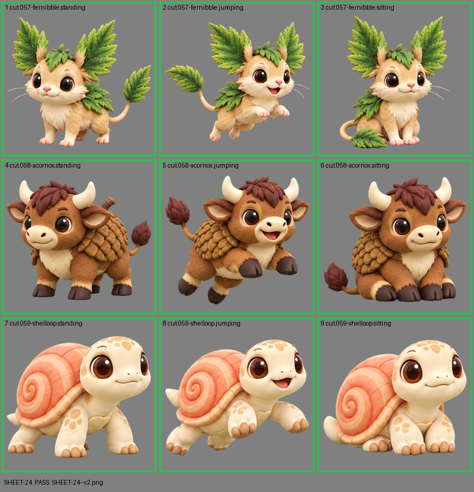

# SHEET-24: Standalone creatures (3 creatures x 3 poses): Fernibble, Acornox, Shelloop

- File: `wildkin-production/incoming/SHEET-24--v2.png`
- sha256: `c930346a462995fb0af242b2b0c7b9acaa99e9897b98dfc6cbadbbeb95183d81`
- Checked: 2026-10-15T05:45:33Z
- Result: **pass**

| Cell | Asset | Result |
|---|---|---|
| 1 | cut.057-fernibble.standing | ok |
| 2 | cut.057-fernibble.jumping | ok |
| 3 | cut.057-fernibble.sitting | ok |
| 4 | cut.058-acornox.standing | ok |
| 5 | cut.058-acornox.jumping | ok |
| 6 | cut.058-acornox.sitting | ok |
| 7 | cut.059-shelloop.standing | ok |
| 8 | cut.059-shelloop.jumping | ok |
| 9 | cut.059-shelloop.sitting | ok |
