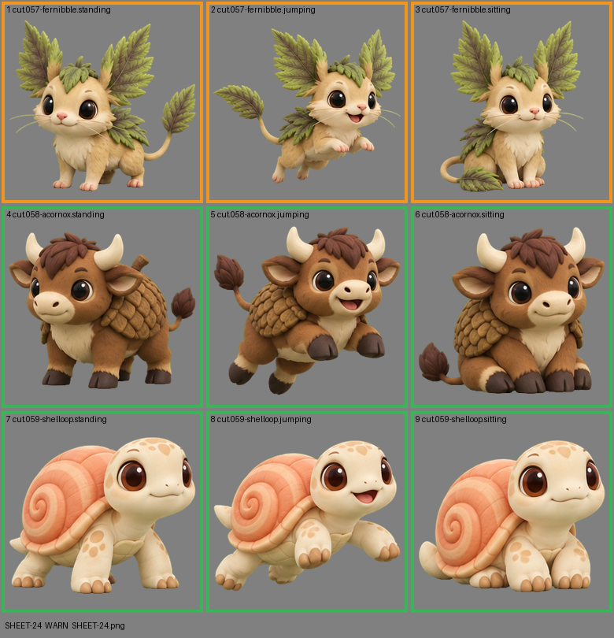

# SHEET-24: Standalone creatures (3 creatures x 3 poses): Fernibble, Acornox, Shelloop

- File: `wildkin-production/incoming/SHEET-24.png`
- sha256: `fb2fac2192364c5fd243b7aff751185165b23cbd01cfe641bf3625b50cb86990`
- Checked: 2026-10-14T01:48:46Z
- Result: **warn**

## Warnings (need a human look)

- cell 1: a lot of half-transparent pixels (43%): soft edges or a glow on the screen
- cell 2: a lot of half-transparent pixels (40%): soft edges or a glow on the screen
- cell 3: a lot of half-transparent pixels (41%): soft edges or a glow on the screen

| Cell | Asset | Result |
|---|---|---|
| 1 | cut.057-fernibble.standing | a lot of half-transparent pixels (43%): soft edges or a glow on the screen |
| 2 | cut.057-fernibble.jumping | a lot of half-transparent pixels (40%): soft edges or a glow on the screen |
| 3 | cut.057-fernibble.sitting | a lot of half-transparent pixels (41%): soft edges or a glow on the screen |
| 4 | cut.058-acornox.standing | ok |
| 5 | cut.058-acornox.jumping | ok |
| 6 | cut.058-acornox.sitting | ok |
| 7 | cut.059-shelloop.standing | ok |
| 8 | cut.059-shelloop.jumping | ok |
| 9 | cut.059-shelloop.sitting | ok |
