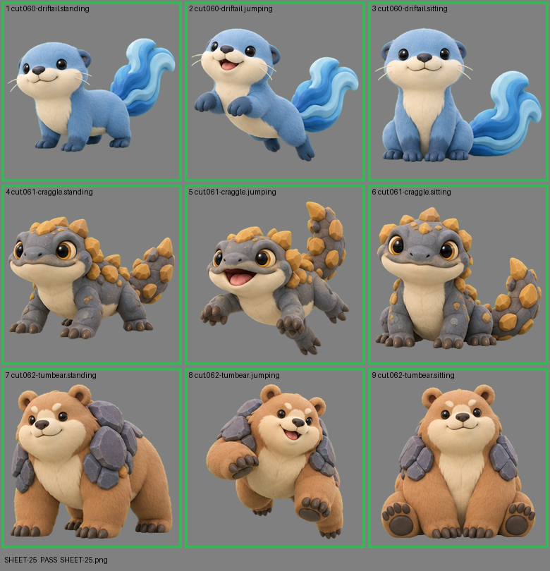

# SHEET-25: Standalone creatures (3 creatures x 3 poses): Driftail, Craggle, Tumbear

- File: `wildkin-production/incoming/SHEET-25.png`
- sha256: `6d905aed8ff87dad909d46d39fc9624948c60e1c0b7b17916327299e83b934eb`
- Checked: 2026-10-14T01:49:03Z
- Result: **pass**

| Cell | Asset | Result |
|---|---|---|
| 1 | cut.060-driftail.standing | ok |
| 2 | cut.060-driftail.jumping | ok |
| 3 | cut.060-driftail.sitting | ok |
| 4 | cut.061-craggle.standing | ok |
| 5 | cut.061-craggle.jumping | ok |
| 6 | cut.061-craggle.sitting | ok |
| 7 | cut.062-tumbear.standing | ok |
| 8 | cut.062-tumbear.jumping | ok |
| 9 | cut.062-tumbear.sitting | ok |
