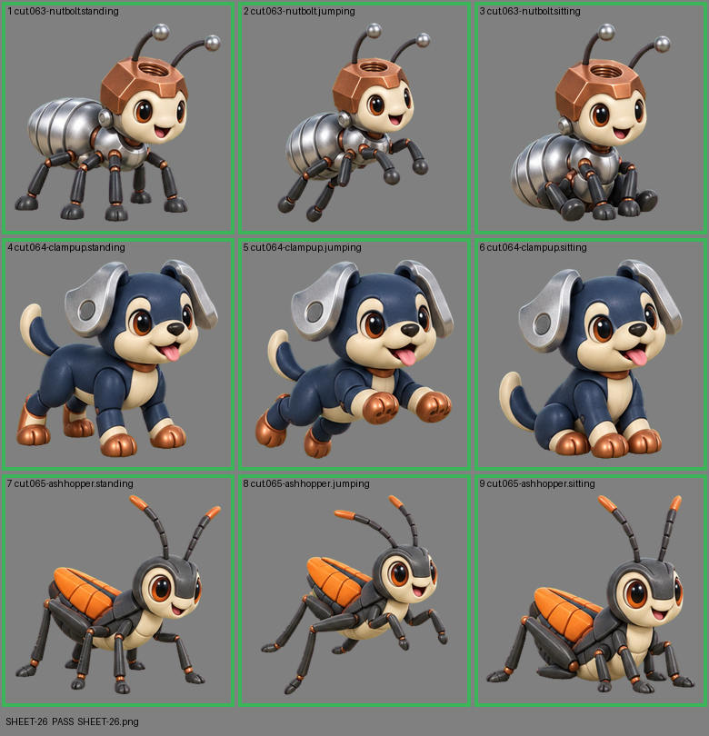

# SHEET-26: Standalone creatures (3 creatures x 3 poses): Nutbolt, Clampup, Ashhopper

- File: `wildkin-production/incoming/SHEET-26.png`
- sha256: `8a708c6065ee696b1fd953c0f20cf9771a941c20b3c57fe57f285b765f2466b7`
- Checked: 2026-10-13T15:47:38Z
- Result: **pass**

| Cell | Asset | Result |
|---|---|---|
| 1 | cut.063-nutbolt.standing | ok |
| 2 | cut.063-nutbolt.jumping | ok |
| 3 | cut.063-nutbolt.sitting | ok |
| 4 | cut.064-clampup.standing | ok |
| 5 | cut.064-clampup.jumping | ok |
| 6 | cut.064-clampup.sitting | ok |
| 7 | cut.065-ashhopper.standing | ok |
| 8 | cut.065-ashhopper.jumping | ok |
| 9 | cut.065-ashhopper.sitting | ok |
