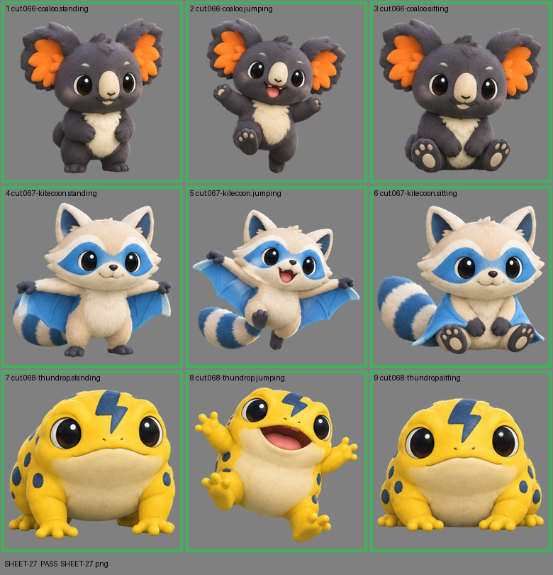

# SHEET-27: Standalone creatures (3 creatures x 3 poses): Coaloo, Kitecoon, Thundrop

- File: `wildkin-production/incoming/SHEET-27.png`
- sha256: `ea22e0f236e4c11183c33c5b29e93f4ce206785cbdeb94c2a2bdfac0be33d779`
- Checked: 2026-10-14T01:49:33Z
- Result: **pass**

| Cell | Asset | Result |
|---|---|---|
| 1 | cut.066-coaloo.standing | ok |
| 2 | cut.066-coaloo.jumping | ok |
| 3 | cut.066-coaloo.sitting | ok |
| 4 | cut.067-kitecoon.standing | ok |
| 5 | cut.067-kitecoon.jumping | ok |
| 6 | cut.067-kitecoon.sitting | ok |
| 7 | cut.068-thundrop.standing | ok |
| 8 | cut.068-thundrop.jumping | ok |
| 9 | cut.068-thundrop.sitting | ok |
