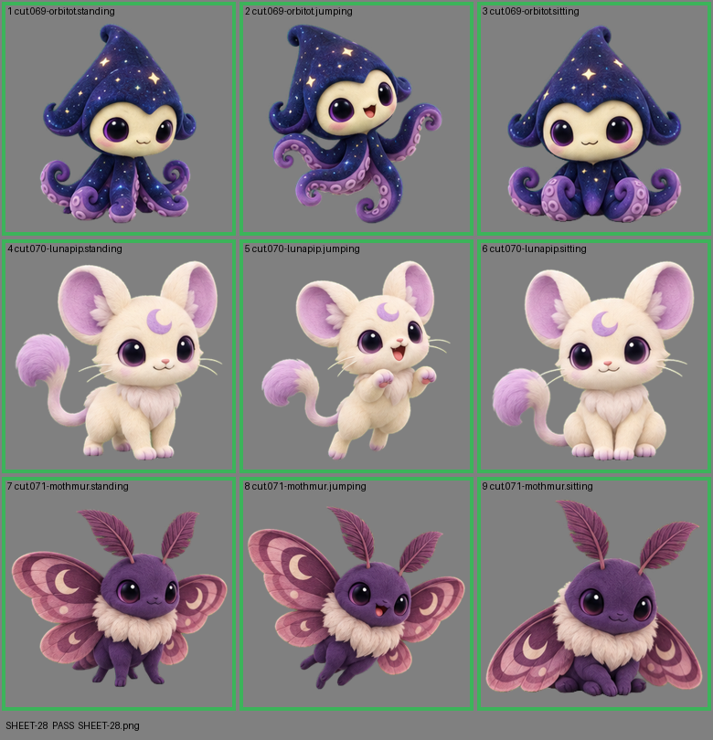

# SHEET-28: Standalone creatures (3 creatures x 3 poses): Orbitot, Lunapip, Mothmur

- File: `wildkin-production/incoming/SHEET-28.png`
- sha256: `4f352fde22619f995a1991d16d678409f91b8afd2bcd274b1122238a8475f804`
- Checked: 2026-10-14T01:49:48Z
- Result: **pass**

| Cell | Asset | Result |
|---|---|---|
| 1 | cut.069-orbitot.standing | ok |
| 2 | cut.069-orbitot.jumping | ok |
| 3 | cut.069-orbitot.sitting | ok |
| 4 | cut.070-lunapip.standing | ok |
| 5 | cut.070-lunapip.jumping | ok |
| 6 | cut.070-lunapip.sitting | ok |
| 7 | cut.071-mothmur.standing | ok |
| 8 | cut.071-mothmur.jumping | ok |
| 9 | cut.071-mothmur.sitting | ok |
