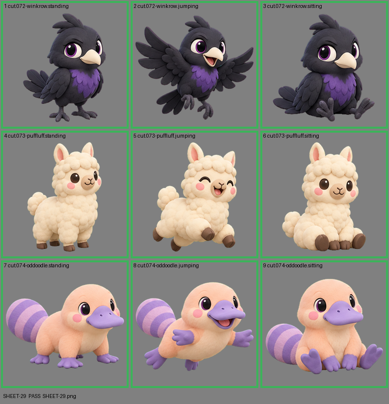

# SHEET-29: Standalone creatures (3 creatures x 3 poses): Winkrow, Puffluff, Oddoodle

- File: `wildkin-production/incoming/SHEET-29.png`
- sha256: `f91070a018b269d0d00ef4c77438e16cacaa996c2a01d520086ccd7b7652aca6`
- Checked: 2026-10-13T15:48:15Z
- Result: **pass**

| Cell | Asset | Result |
|---|---|---|
| 1 | cut.072-winkrow.standing | ok |
| 2 | cut.072-winkrow.jumping | ok |
| 3 | cut.072-winkrow.sitting | ok |
| 4 | cut.073-puffluff.standing | ok |
| 5 | cut.073-puffluff.jumping | ok |
| 6 | cut.073-puffluff.sitting | ok |
| 7 | cut.074-oddoodle.standing | ok |
| 8 | cut.074-oddoodle.jumping | ok |
| 9 | cut.074-oddoodle.sitting | ok |
