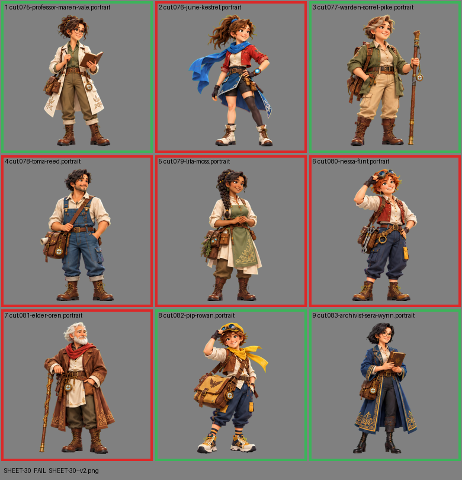

# SHEET-30: Allies sheet A: Professor Maren Vale, June Kestrel, Warden Sorrel Pike, Toma Reed, Lita Moss, Nessa Flint, Elder Oren, Pip Rowan, Archivist Sera Wynn

- File: `wildkin-production/incoming/SHEET-30--v2.png`
- sha256: `1c66e7d85689c503b59f53a728c9d097deaea122b2afe9535973ceb73a20a2b0`
- Checked: 2026-10-14T01:50:20Z
- Result: **fail**

## Errors (block approval)

- cell 2: subject touches the cell edge (clipped): bottom
- cell 4: subject touches the cell edge (clipped): bottom
- cell 5: subject touches the cell edge (clipped): bottom
- cell 6: subject touches the cell edge (clipped): bottom
- cell 7: subject touches the cell edge (clipped): top

## Notes (do not block)

- cell 1: margin is tight (3 px); the spec asks for about 10%
- cell 3: margin is tight (3 px); the spec asks for about 10%
- cell 9: margin is tight (12 px); the spec asks for about 10%

| Cell | Asset | Result |
|---|---|---|
| 1 | cut.075-professor-maren-vale.portrait | ok |
| 2 | cut.076-june-kestrel.portrait | subject touches the cell edge (clipped): bottom |
| 3 | cut.077-warden-sorrel-pike.portrait | ok |
| 4 | cut.078-toma-reed.portrait | subject touches the cell edge (clipped): bottom |
| 5 | cut.079-lita-moss.portrait | subject touches the cell edge (clipped): bottom |
| 6 | cut.080-nessa-flint.portrait | subject touches the cell edge (clipped): bottom |
| 7 | cut.081-elder-oren.portrait | subject touches the cell edge (clipped): top |
| 8 | cut.082-pip-rowan.portrait | ok |
| 9 | cut.083-archivist-sera-wynn.portrait | ok |
