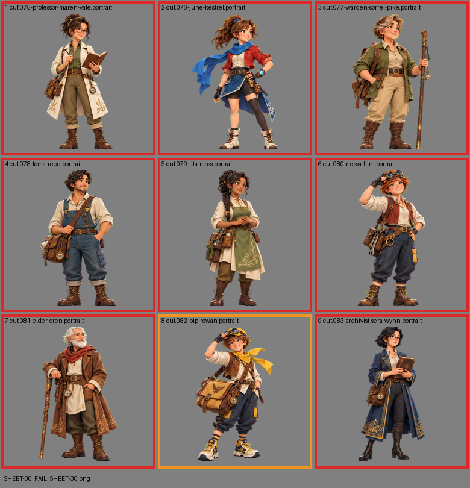

# SHEET-30: Allies sheet A: Professor Maren Vale, June Kestrel, Warden Sorrel Pike, Toma Reed, Lita Moss, Nessa Flint, Elder Oren, Pip Rowan, Archivist Sera Wynn

- File: `wildkin-production/incoming/SHEET-30.png`
- sha256: `7605b05aa6b6aec929a2368a9e02d7c324b4692cc92e0570a1834e3b610c0623`
- Checked: 2026-10-14T01:50:35Z
- Result: **fail**

## Errors (block approval)

- cell 1: subject touches the cell edge (clipped): top+bottom
- cell 2: subject touches the cell edge (clipped): bottom
- cell 3: subject touches the cell edge (clipped): top+bottom
- cell 4: subject touches the cell edge (clipped): top+bottom
- cell 5: subject touches the cell edge (clipped): top+bottom
- cell 6: subject touches the cell edge (clipped): top+bottom
- cell 7: subject touches the cell edge (clipped): top
- cell 9: subject touches the cell edge (clipped): top

## Warnings (need a human look)

- cell 1: background is not a clean flat screen (median [28, 234, 36])
- cell 2: background is not a clean flat screen (median [28, 234, 36])
- cell 3: background is not a clean flat screen (median [27, 234, 36])
- cell 4: background is not a clean flat screen (median [28, 234, 36])
- cell 5: background is not a clean flat screen (median [28, 234, 36])
- cell 6: background is not a clean flat screen (median [28, 234, 37])
- cell 7: background is not a clean flat screen (median [28, 234, 37])
- cell 8: background is not a clean flat screen (median [28, 233, 36])
- cell 9: background is not a clean flat screen (median [253, 1, 200])

## Notes (do not block)

- cell 8: margin is tight (3 px); the spec asks for about 10%

| Cell | Asset | Result |
|---|---|---|
| 1 | cut.075-professor-maren-vale.portrait | subject touches the cell edge (clipped): top+bottom; background is not a clean flat screen (median [28, 234, 36]) |
| 2 | cut.076-june-kestrel.portrait | subject touches the cell edge (clipped): bottom; background is not a clean flat screen (median [28, 234, 36]) |
| 3 | cut.077-warden-sorrel-pike.portrait | subject touches the cell edge (clipped): top+bottom; background is not a clean flat screen (median [27, 234, 36]) |
| 4 | cut.078-toma-reed.portrait | subject touches the cell edge (clipped): top+bottom; background is not a clean flat screen (median [28, 234, 36]) |
| 5 | cut.079-lita-moss.portrait | subject touches the cell edge (clipped): top+bottom; background is not a clean flat screen (median [28, 234, 36]) |
| 6 | cut.080-nessa-flint.portrait | subject touches the cell edge (clipped): top+bottom; background is not a clean flat screen (median [28, 234, 37]) |
| 7 | cut.081-elder-oren.portrait | subject touches the cell edge (clipped): top; background is not a clean flat screen (median [28, 234, 37]) |
| 8 | cut.082-pip-rowan.portrait | background is not a clean flat screen (median [28, 233, 36]) |
| 9 | cut.083-archivist-sera-wynn.portrait | subject touches the cell edge (clipped): top; background is not a clean flat screen (median [253, 1, 200]) |
