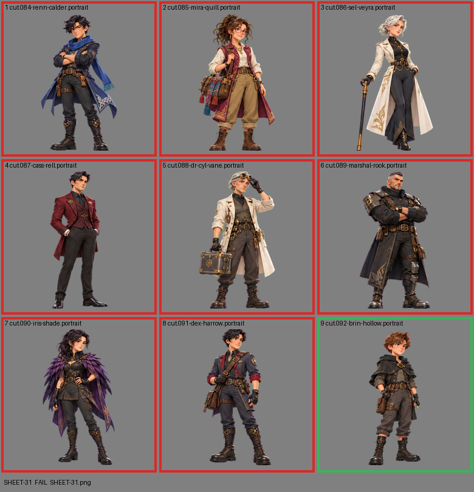

# SHEET-31: Allies sheet B: Renn Calder, Mira Quill, Sel Veyra, Cass Rell, Dr. Cyl Vane, Marshal Rook, Iris Shade, Dex Harrow, Brin Hollow

- File: `wildkin-production/incoming/SHEET-31.png`
- sha256: `9aa5686db7b775135aab50d18a7f6121acd6e3cd1f013d238f3ddc9bd73f671f`
- Checked: 2026-10-14T01:50:54Z
- Result: **fail**

## Errors (block approval)

- cell 1: subject touches the cell edge (clipped): bottom
- cell 2: subject touches the cell edge (clipped): top+bottom
- cell 3: subject touches the cell edge (clipped): bottom
- cell 4: subject touches the cell edge (clipped): top+bottom
- cell 5: subject touches the cell edge (clipped): top+bottom
- cell 6: subject touches the cell edge (clipped): top+bottom
- cell 7: subject touches the cell edge (clipped): top
- cell 8: subject touches the cell edge (clipped): top

## Warnings (need a human look)

- cell 1: background is not a clean flat screen (median [28, 236, 25])
- cell 2: background is not a clean flat screen (median [28, 235, 25])
- cell 3: background is not a clean flat screen (median [28, 235, 26])
- cell 4: background is not a clean flat screen (median [28, 236, 25])
- cell 5: background is not a clean flat screen (median [28, 235, 25])
- cell 6: background is not a clean flat screen (median [28, 235, 26])
- cell 7: background is not a clean flat screen (median [28, 236, 25])
- cell 8: background is not a clean flat screen (median [28, 235, 26])

## Notes (do not block)

- cell 9: margin is tight (3 px); the spec asks for about 10%

| Cell | Asset | Result |
|---|---|---|
| 1 | cut.084-renn-calder.portrait | subject touches the cell edge (clipped): bottom; background is not a clean flat screen (median [28, 236, 25]) |
| 2 | cut.085-mira-quill.portrait | subject touches the cell edge (clipped): top+bottom; background is not a clean flat screen (median [28, 235, 25]) |
| 3 | cut.086-sel-veyra.portrait | subject touches the cell edge (clipped): bottom; background is not a clean flat screen (median [28, 235, 26]) |
| 4 | cut.087-cass-rell.portrait | subject touches the cell edge (clipped): top+bottom; background is not a clean flat screen (median [28, 236, 25]) |
| 5 | cut.088-dr-cyl-vane.portrait | subject touches the cell edge (clipped): top+bottom; background is not a clean flat screen (median [28, 235, 25]) |
| 6 | cut.089-marshal-rook.portrait | subject touches the cell edge (clipped): top+bottom; background is not a clean flat screen (median [28, 235, 26]) |
| 7 | cut.090-iris-shade.portrait | subject touches the cell edge (clipped): top; background is not a clean flat screen (median [28, 236, 25]) |
| 8 | cut.091-dex-harrow.portrait | subject touches the cell edge (clipped): top; background is not a clean flat screen (median [28, 235, 26]) |
| 9 | cut.092-brin-hollow.portrait | ok |
