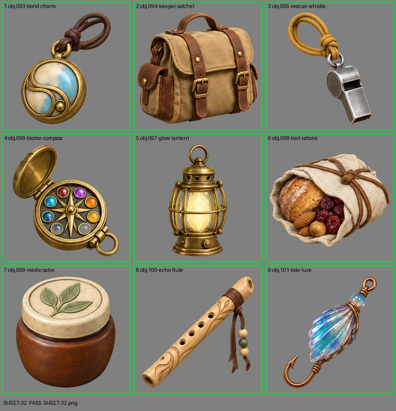

# SHEET-32: Gear sheet A: Bond Charm, Keeper Satchel, Rescue Whistle, Biome Compass, Glow Lantern, Trail Rations, Medic Salve, Echo Flute, Tide Lure

- File: `wildkin-production/incoming/SHEET-32.png`
- sha256: `cf526848c5bb4f32ee28b6d0fc2c722277ebd2f3d31e8aed712615e11fc8fcc9`
- Checked: 2026-10-13T15:55:10Z
- Result: **pass**

## Notes (do not block)

- cell 4: margin is tight (11 px); the spec asks for about 10%
- cell 5: margin is tight (9 px); the spec asks for about 10%

| Cell | Asset | Result |
|---|---|---|
| 1 | obj.093-bond-charm | ok |
| 2 | obj.094-keeper-satchel | ok |
| 3 | obj.095-rescue-whistle | ok |
| 4 | obj.096-biome-compass | ok |
| 5 | obj.097-glow-lantern | ok |
| 6 | obj.098-trail-rations | ok |
| 7 | obj.099-medic-salve | ok |
| 8 | obj.100-echo-flute | ok |
| 9 | obj.101-tide-lure | ok |
