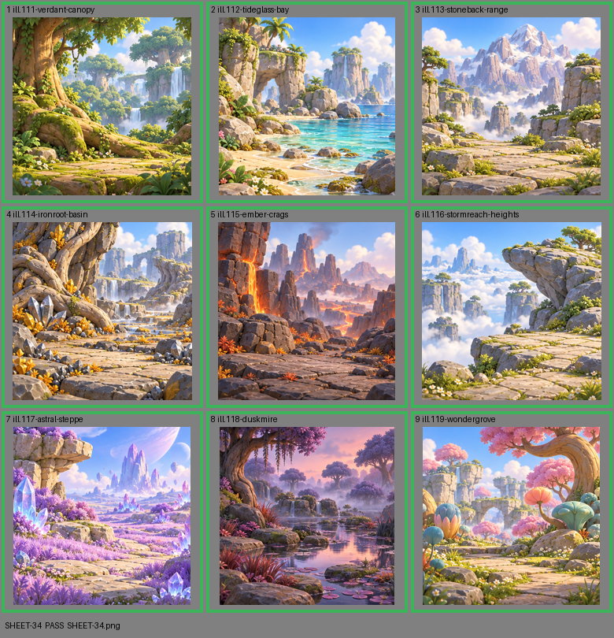

# SHEET-34: Biomes A: one illustration per biome card

- File: `wildkin-production/incoming/SHEET-34.png`
- sha256: `9bff7a1d1f149840566d581754ddefd32cdda7a3ea25bf3d6c85c0cfadb216e3`
- Checked: 2026-10-13T05:19:46Z
- Result: **pass**

| Cell | Asset | Result |
|---|---|---|
| 1 | ill.111-verdant-canopy | ok |
| 2 | ill.112-tideglass-bay | ok |
| 3 | ill.113-stoneback-range | ok |
| 4 | ill.114-ironroot-basin | ok |
| 5 | ill.115-ember-crags | ok |
| 6 | ill.116-stormreach-heights | ok |
| 7 | ill.117-astral-steppe | ok |
| 8 | ill.118-duskmire | ok |
| 9 | ill.119-wondergrove | ok |
