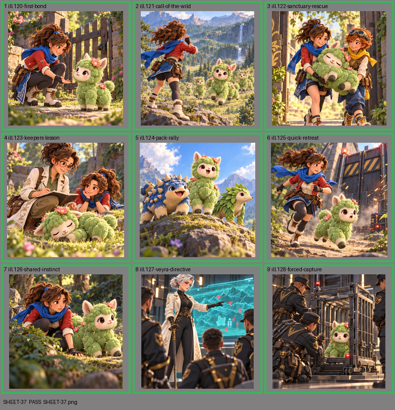

# SHEET-37: Tactics A

- File: `wildkin-production/incoming/SHEET-37.png`
- sha256: `2e02399291ad09ea9678f5c5afa36a0f6b336ec3cf191275b7f25352b8e8029b`
- Checked: 2026-10-15T05:45:55Z
- Result: **pass**

| Cell | Asset | Result |
|---|---|---|
| 1 | ill.120-first-bond | ok |
| 2 | ill.121-call-of-the-wild | ok |
| 3 | ill.122-sanctuary-rescue | ok |
| 4 | ill.123-keepers-lesson | ok |
| 5 | ill.124-pack-rally | ok |
| 6 | ill.125-quick-retreat | ok |
| 7 | ill.126-shared-instinct | ok |
| 8 | ill.127-veyra-directive | ok |
| 9 | ill.128-forced-capture | ok |
