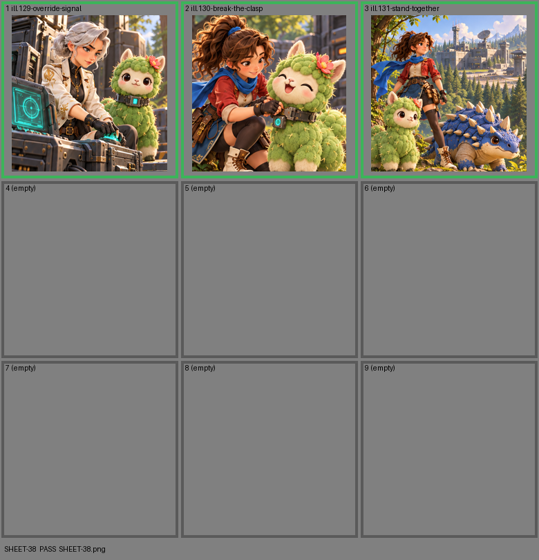

# SHEET-38: Tactics B

- File: `wildkin-production/incoming/SHEET-38.png`
- sha256: `379031cf42706673329860c062938fd9e2982447953bf6607d148f2916aaecad`
- Checked: 2026-10-15T05:45:55Z
- Result: **pass**

| Cell | Asset | Result |
|---|---|---|
| 1 | ill.129-override-signal | ok |
| 2 | ill.130-break-the-clasp | ok |
| 3 | ill.131-stand-together | ok |
| 4 | (empty) | empty as asked |
| 5 | (empty) | empty as asked |
| 6 | (empty) | empty as asked |
| 7 | (empty) | empty as asked |
| 8 | (empty) | empty as asked |
| 9 | (empty) | empty as asked |
