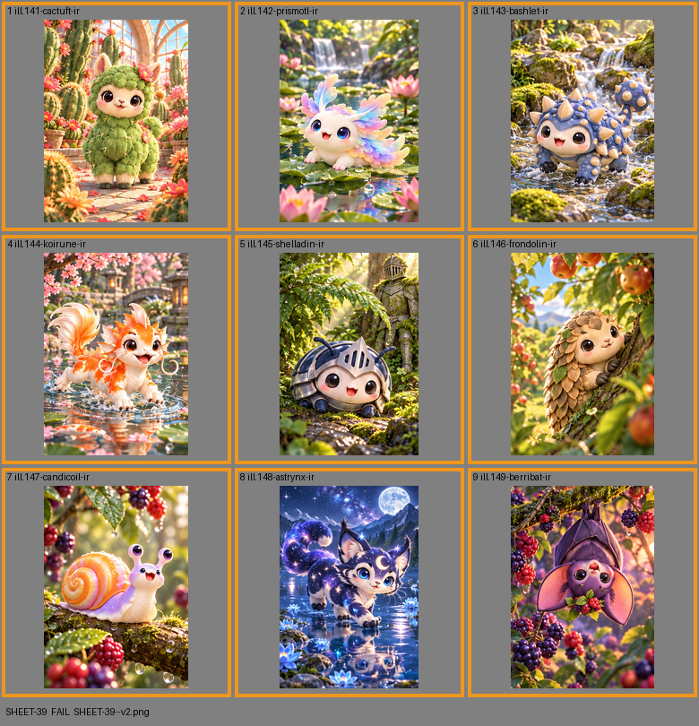

# SHEET-39: Illustration Rares A

- File: `wildkin-production/incoming/SHEET-39--v2.png`
- sha256: `9231bc7fd6794a1249ef25e82a67d99241ac2bf10652559aa4ac80483c152cd7`
- Checked: 2026-10-15T05:45:55Z
- Result: **fail**

## Errors (block approval)

- too small: 1060x1484, need at least 2100x2940

## Warnings (need a human look)

- cell 1: cell is only 340 px wide; card art wants 700+
- cell 2: cell is only 326 px wide; card art wants 700+
- cell 3: cell is only 336 px wide; card art wants 700+
- cell 4: cell is only 340 px wide; card art wants 700+
- cell 5: cell is only 326 px wide; card art wants 700+
- cell 6: cell is only 336 px wide; card art wants 700+
- cell 7: cell is only 340 px wide; card art wants 700+
- cell 8: cell is only 326 px wide; card art wants 700+
- cell 9: cell is only 336 px wide; card art wants 700+

| Cell | Asset | Result |
|---|---|---|
| 1 | ill.141-cactuft-ir | cell is only 340 px wide; card art wants 700+ |
| 2 | ill.142-prismotl-ir | cell is only 326 px wide; card art wants 700+ |
| 3 | ill.143-bashlet-ir | cell is only 336 px wide; card art wants 700+ |
| 4 | ill.144-koirune-ir | cell is only 340 px wide; card art wants 700+ |
| 5 | ill.145-shelladin-ir | cell is only 326 px wide; card art wants 700+ |
| 6 | ill.146-frondolin-ir | cell is only 336 px wide; card art wants 700+ |
| 7 | ill.147-candicoil-ir | cell is only 340 px wide; card art wants 700+ |
| 8 | ill.148-astrynx-ir | cell is only 326 px wide; card art wants 700+ |
| 9 | ill.149-berribat-ir | cell is only 336 px wide; card art wants 700+ |
