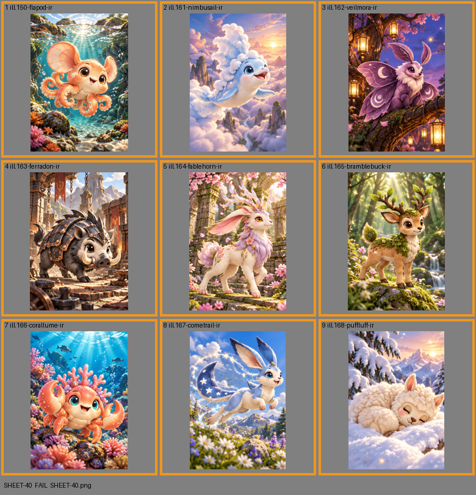

# SHEET-40: Illustration Rares B

- File: `wildkin-production/incoming/SHEET-40.png`
- sha256: `8a793ac201b38f8b9c01c89440d81626c66eba76f38c72e20806506eff5b6010`
- Checked: 2026-10-15T05:45:56Z
- Result: **fail**

## Errors (block approval)

- too small: 1060x1484, need at least 2100x2940

## Warnings (need a human look)

- cell 1: cell is only 337 px wide; card art wants 700+
- cell 2: cell is only 333 px wide; card art wants 700+
- cell 3: cell is only 333 px wide; card art wants 700+
- cell 4: cell is only 337 px wide; card art wants 700+
- cell 5: cell is only 333 px wide; card art wants 700+
- cell 6: cell is only 333 px wide; card art wants 700+
- cell 7: cell is only 337 px wide; card art wants 700+
- cell 8: cell is only 333 px wide; card art wants 700+
- cell 9: cell is only 333 px wide; card art wants 700+

| Cell | Asset | Result |
|---|---|---|
| 1 | ill.150-flapod-ir | cell is only 337 px wide; card art wants 700+ |
| 2 | ill.161-nimbusail-ir | cell is only 333 px wide; card art wants 700+ |
| 3 | ill.162-veilmora-ir | cell is only 333 px wide; card art wants 700+ |
| 4 | ill.163-ferradon-ir | cell is only 337 px wide; card art wants 700+ |
| 5 | ill.164-fablehorn-ir | cell is only 333 px wide; card art wants 700+ |
| 6 | ill.165-bramblebuck-ir | cell is only 333 px wide; card art wants 700+ |
| 7 | ill.166-corallume-ir | cell is only 337 px wide; card art wants 700+ |
| 8 | ill.167-cometrail-ir | cell is only 333 px wide; card art wants 700+ |
| 9 | ill.168-puffluff-ir | cell is only 333 px wide; card art wants 700+ |
