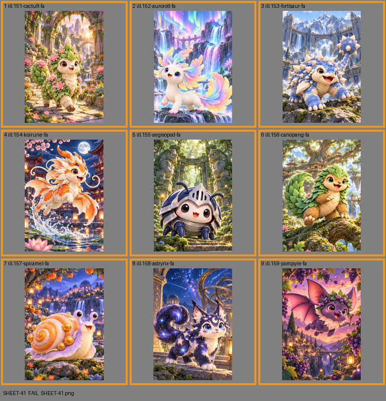

# SHEET-41: Full Arts A

- File: `wildkin-production/incoming/SHEET-41.png`
- sha256: `981563a0a44d2c738faf488c297c44396f73e12e3433e0219a64afcc19cd00f2`
- Checked: 2026-10-15T05:45:57Z
- Result: **fail**

## Errors (block approval)

- too small: 1060x1484, need at least 2100x2940

## Warnings (need a human look)

- cell 1: cell is only 336 px wide; card art wants 700+
- cell 2: cell is only 334 px wide; card art wants 700+
- cell 3: cell is only 334 px wide; card art wants 700+
- cell 4: cell is only 336 px wide; card art wants 700+
- cell 5: cell is only 334 px wide; card art wants 700+
- cell 6: cell is only 334 px wide; card art wants 700+
- cell 7: cell is only 336 px wide; card art wants 700+
- cell 8: cell is only 334 px wide; card art wants 700+
- cell 9: cell is only 334 px wide; card art wants 700+

| Cell | Asset | Result |
|---|---|---|
| 1 | ill.151-cactuft-fa | cell is only 336 px wide; card art wants 700+ |
| 2 | ill.152-aurorotl-fa | cell is only 334 px wide; card art wants 700+ |
| 3 | ill.153-fortisaur-fa | cell is only 334 px wide; card art wants 700+ |
| 4 | ill.154-koirune-fa | cell is only 336 px wide; card art wants 700+ |
| 5 | ill.155-aegisopod-fa | cell is only 334 px wide; card art wants 700+ |
| 6 | ill.156-canopang-fa | cell is only 334 px wide; card art wants 700+ |
| 7 | ill.157-spiramel-fa | cell is only 336 px wide; card art wants 700+ |
| 8 | ill.158-astrynx-fa | cell is only 334 px wide; card art wants 700+ |
| 9 | ill.159-pompyre-fa | cell is only 334 px wide; card art wants 700+ |
