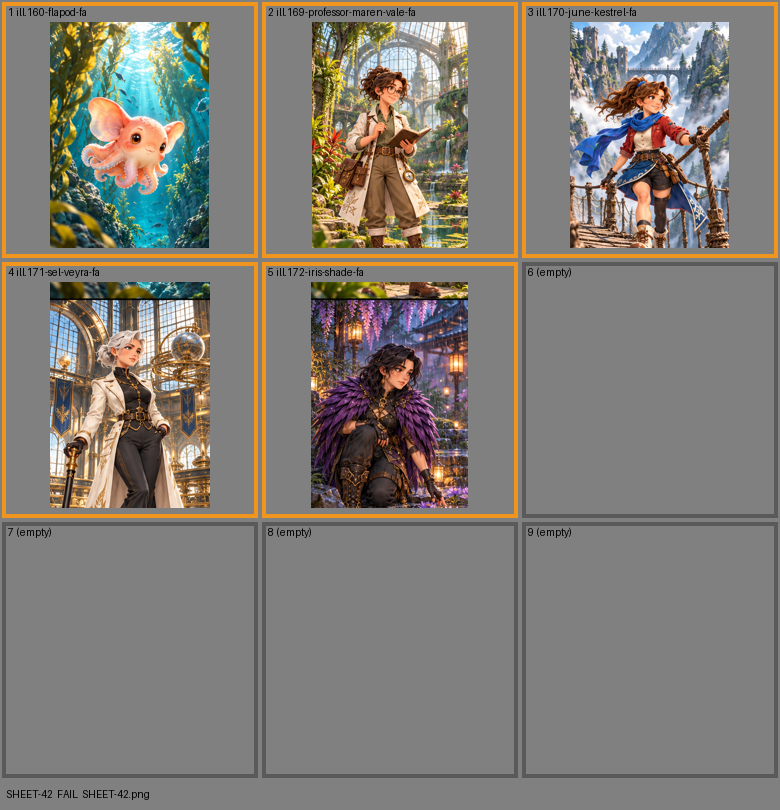

# SHEET-42: Full Arts B

- File: `wildkin-production/incoming/SHEET-42.png`
- sha256: `e6c45ed5d64c4915f088db13cdcc2514d49fbdf17684e76221a9a2e850b831f1`
- Checked: 2026-10-15T05:45:58Z
- Result: **fail**

## Errors (block approval)

- too small: 1060x1484, need at least 2100x2940

## Warnings (need a human look)

- cell 1: cell is only 337 px wide; card art wants 700+
- cell 2: cell is only 331 px wide; card art wants 700+
- cell 3: cell is only 337 px wide; card art wants 700+
- cell 4: cell is only 337 px wide; card art wants 700+
- cell 5: cell is only 331 px wide; card art wants 700+
- cell 6: this cell should be empty but has an image in it
- cell 7: this cell should be empty but has an image in it
- cell 8: this cell should be empty but has an image in it

| Cell | Asset | Result |
|---|---|---|
| 1 | ill.160-flapod-fa | cell is only 337 px wide; card art wants 700+ |
| 2 | ill.169-professor-maren-vale-fa | cell is only 331 px wide; card art wants 700+ |
| 3 | ill.170-june-kestrel-fa | cell is only 337 px wide; card art wants 700+ |
| 4 | ill.171-sel-veyra-fa | cell is only 337 px wide; card art wants 700+ |
| 5 | ill.172-iris-shade-fa | cell is only 331 px wide; card art wants 700+ |
| 6 | (empty) | this cell should be empty but has an image in it |
| 7 | (empty) | this cell should be empty but has an image in it |
| 8 | (empty) | this cell should be empty but has an image in it |
| 9 | (empty) | empty as asked |
