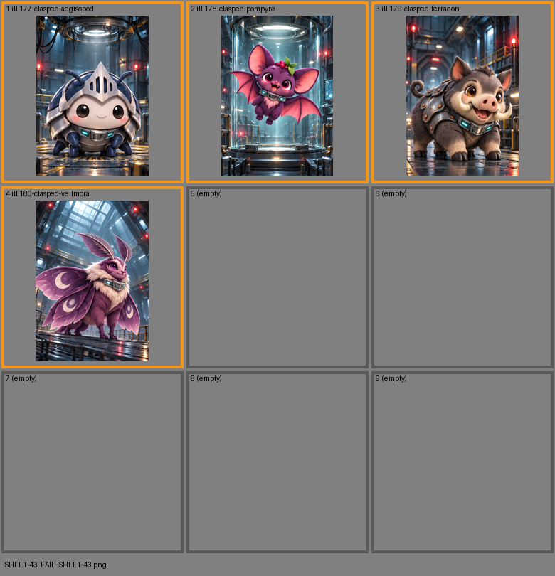

# SHEET-43: Clasp Program: Clasped Secret Rares

- File: `wildkin-production/incoming/SHEET-43.png`
- sha256: `c4ab5e8516f626c79b9c760b9f69e24bc2d5f475549860fd5533c648662e7c01`
- Checked: 2026-10-15T05:45:58Z
- Result: **fail**

## Errors (block approval)

- too small: 1060x1484, need at least 2100x2940

## Warnings (need a human look)

- cell 1: cell is only 333 px wide; card art wants 700+
- cell 2: cell is only 330 px wide; card art wants 700+
- cell 3: cell is only 333 px wide; card art wants 700+
- cell 4: cell is only 333 px wide; card art wants 700+

| Cell | Asset | Result |
|---|---|---|
| 1 | ill.177-clasped-aegisopod | cell is only 333 px wide; card art wants 700+ |
| 2 | ill.178-clasped-pompyre | cell is only 330 px wide; card art wants 700+ |
| 3 | ill.179-clasped-ferradon | cell is only 333 px wide; card art wants 700+ |
| 4 | ill.180-clasped-veilmora | cell is only 333 px wide; card art wants 700+ |
| 5 | (empty) | empty as asked |
| 6 | (empty) | empty as asked |
| 7 | (empty) | empty as asked |
| 8 | (empty) | empty as asked |
| 9 | (empty) | empty as asked |
